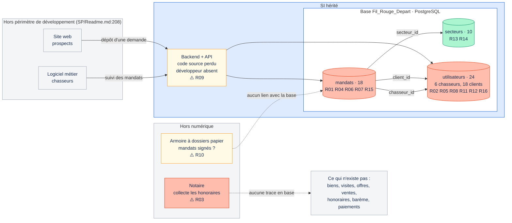

# Livrable 1 — cartographie du SI existant et de ses risques

> Phase 1, BC01 : « Schématiser une cartographie du SI en utilisant une
> méthode d'analyse de risques » (`SP/Readme.md:222`). Format cible :
> 1 schéma (`SP/documents utiles/GRILLE-EVALUATION.md`).
>
> Reprise en Mermaid, le 2026-11-19, de la page Confluence « Cartographie du
> SI + analyse de risques » (Sébastien, 05/08/2026). Cette page ne contient que
> 5 images : le schéma ci-dessous les **reconstruit** d'après son texte, le sujet
> et les fixtures.
>
> Date de référence : **25/07/2026** (`SP/Readme.md:308`).

## Le schéma

Chaque risque `Rnn` est posé sur le composant qu'il touche. Sa cote
(probabilité × impact, de 1 à 9) et sa description sont dans le registre
([`02-registre-anomalies-risques.md`](02-registre-anomalies-risques.md)).

Couleurs : la palette des tableaux Confluence de l'équipe (grille
d'auto-évaluation, note de cadrage).

- 🟥 Rouge `#ffbdad` : au moins un risque coté 7 à 9 (priorité absolue).
- 🟨 Jaune `#fffae6` : risques cotés 4 à 6 (impératifs).
- 🟩 Vert `#abf5d1` : risques cotés 1 à 3 (mineurs).
- ⬜ Gris `#f4f5f7` : hors périmètre, ou ce qui n'existe pas.
- 🟦 Bleu `#deebff` : le cadre du SI hérité.
- Les deux flèches `client_id` et `chasseur_id` vont vers **la même table** :
  c'est la cause structurelle de R01 et R06.

## La matrice des risques (probabilité × impact)

| Probabilité ↓ / Impact → | 1 — gêne | 2 — fonction dégradée | 3 — juridique, financier ou bloquant |
|---|---|---|---|
| **3 — constaté dans les données** | 🟩 *(3)* | 🟨 R05, R07, R08, R09 *(6)* | 🟥 **R01, R02, R03** *(9)* |
| **2 — possible, rien ne l'empêche** | 🟩 R13 *(2)* | 🟨 R12 *(4)* | 🟨 R04, R06, R10, R16 *(6)* |
| **1 — peu probable** | 🟩 *(1)* | 🟩 R11, R14, R15 *(2)* | 🟩 *(3)* |

Entre parenthèses : la cote de la case. 🟥 7 à 9 · 🟨 4 à 6 · 🟩 1 à 3.

**Rnn = risque n° nn** du registre
([`02-registre-anomalies-risques.md`](02-registre-anomalies-risques.md), preuves
et cotes détaillées). En bref :

- 🟥 **R01** statut « actif » faux : 6 mandats sur 11 ont dépassé leurs 6 mois.
- 🟥 **R02** un chasseur enregistré comme client (mandat 13).
- 🟥 **R03** les honoraires n'existent nulle part en base.
- 🟨 **R04** ni date de signature, ni date de fin de mandat.
- 🟨 **R05** clients et chasseurs dans la même table : colonnes vides.
- 🟨 **R06** client et chasseur visent la même table, rôle non contrôlé.
- 🟨 **R07** critères de recherche en texte libre.
- 🟨 **R08** taux de commission fixe, au lieu d'un barème par tranches.
- 🟨 **R09** code source du backend perdu, développeur absent.
- 🟨 **R10** dossiers papier sans lien avec la base.
- 🟨 **R12** téléphone sans format ni indicatif, parfois vide.
- 🟨 **R16** données personnelles en clair, sans droits par rôle.
- 🟩 **R11** email sans contrôle de format.
- 🟩 **R13** code postal sans contrôle.
- 🟩 **R14** pas d'unicité sur (ville, quartier).
- 🟩 **R15** un seul secteur par mandat.

Comptes : 🟥 **3** risques cotés 9, 🟨 **9** cotés 4 à 6, 🟩 **4** cotés 1 à 3.
**16** au total, la même répartition que l'analyse
([`03-analyse.md`](03-analyse.md)) et la page Confluence « Audit du système
d'information ».

## Comment ce schéma a été fait

1. **Inventorier les composants** : la liste du sujet (`SP/Readme.md:205-210`),
   plus deux éléments hors base, l'armoire et le notaire (`SP/Readme.md:78`).
2. **Relever les risques** : les 13 annotations du consultant
   (`fixtures/PgSQL.sql`, préfixe `-- [consultant]`), puis notre relecture du
   schéma et des données, croisée avec les règles métier du sujet.
3. **Coter** : probabilité de 1 à 3 (3 = déjà arrivé dans les données),
   impact de 1 à 3 (3 = risque juridique, perte d'argent, ou blocage du
   projet) ; cote = produit.
4. **Poser** chaque risque sur le composant qu'il touche.
