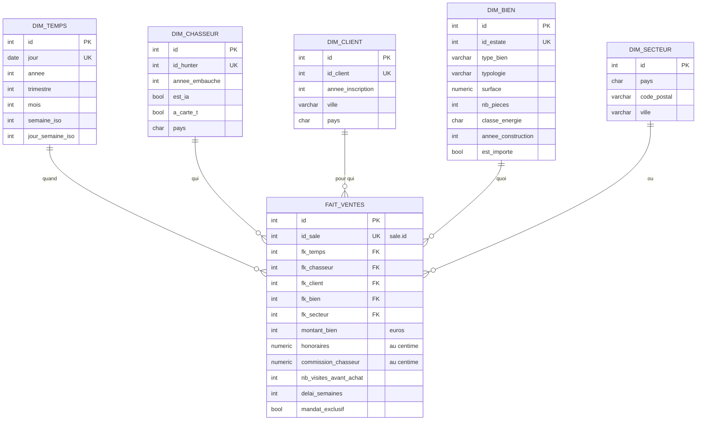

# OLAP — notre schéma analytique et son alimentation

> Livrable BC05 « Schéma analytique (OLAP) + alimentation des données » :
> « 1 schéma + description (script SQL ou code) » (StarterPack - BASE,
> `documents utiles/GRILLE-EVALUATION.md:29`). Le cours et le modèle sont
> dans `documents utiles/OLAP.md` du StarterPack ; ce fichier-ci est **notre**
> réponse. Chantier FLX, fiches FLX5 (schéma) et FLX6 (alimentation), 2026-10-15.

## La matrice de cadrage, remplie

| Élément | Notre choix |
|---|---|
| **Question métier** | la performance des chasseurs et des ventes : commissions, délais, visites, par période, par secteur, par type de bien |
| **Grain du fait** | **une vente** : une ligne de `sale` donne une ligne de `olap.fait_ventes` |
| **Mesures** | `montant_bien`, `honoraires`, `commission_chasseur`, `nb_visites_avant_achat`, `delai_semaines`, `mandat_exclusif` |
| **Dimensions** | `dim_temps`, `dim_chasseur`, `dim_client`, `dim_bien`, `dim_secteur` |
| **Sources OLTP** | `sale`, `payment`, `mandate`, `visit`, `hunter`, `client`, `estate` |
| **Fréquence de rafraîchissement** | chaque nuit à 3 h (DAG `olap_refresh`) |

## Le schéma

Les noms sont ceux du sujet, pour se lire à côté de `OLAP.md`. Le script :
`docker/init-v3/08_olap.sql` (dépôt Fil-Rouge-API), et sa migration jumelle
`docker/migrations/v2-vers-v3/49_schema-olap.sql`.

### D'où vient chaque mesure

| Mesure | Source OLTP | Calcul |
|---|---|---|
| `montant_bien` | `sale.purchase_amount` | tel quel, en euros entiers |
| `honoraires` | `sale.fees_amount` | tel quel, au centime |
| `commission_chasseur` | `payment.amount` | tel quel ; vide tant que la vente n'a pas de paiement |
| `nb_visites_avant_achat` | `visit` | visites de type client sur la chaîne de mandats de la vente, au plus tard le jour de l'acte |
| `delai_semaines` | `sale.signature_date`, `mandate.signature_date` | (jour de l'acte − signature du premier mandat de la chaîne) ÷ 7, arrondi vers le bas |
| `mandat_exclusif` | `mandate.is_exclusive` | tel quel |

## L'alimentation

Le DAG Airflow `olap_refresh`, chaque nuit à 3 h, suit les trois temps du cours
(dépôt Fil-Rouge-API) :

1. **Extraire** — `airflow/src/olap/extract.py` lit les tables OLTP.
2. **Transformer** — `airflow/src/olap/transform.py` construit l'étoile, calcule
   les mesures, et écarte les ventes incohérentes avec leur raison (une vente
   avant la signature de son mandat, une clé inconnue).
3. **Charger** — `airflow/src/olap/load.py` vide les six tables, les recharge,
   le tout dans une seule transaction.

La tâche `report` écrit ensuite le bilan (lues, chargées, rejetées par raison)
dans MinIO, `gold/olap/{ds}.json`.

Mesuré le 2026-10-15 (fiche FLX6), sur 501 ventes fausses du faker (FLX13) :
501 lues, 501 chargées, 0 rejet ; rejoué : toujours 501 lignes dans
`fait_ventes`.

## Décision / conclusion

Le grain est **une vente** : c'est la ligne qui porte à la fois le montant,
les honoraires et la commission, et toutes les questions du sujet se posent
« par vente ». Nous gardons l'**étoile** du sujet, avec ses cinq dimensions
plates : à notre volume (quelques centaines de ventes), le flocon n'apporterait
que des jointures. L'OLAP est **rechargé en entier chaque nuit** à 3 h, après
l'import des annonces : c'est simple, sans doublon possible, et assez rapide à
cette taille ; les dimensions des personnes n'ont **aucun nom, e-mail ni
téléphone** (RGPD).

## Limites connues

- Le rechargement complet ne tiendra plus à des millions de ventes : il
  faudra charger seulement les nouvelles.
- Le schéma `olap` est fermé au rôle en lecture seule `fil_rouge_reader` :
  `commission_chasseur` vient de `payment`, que ce rôle ne lit plus
  (migration 43). Un lecteur de l'OLAP reste à décider.
