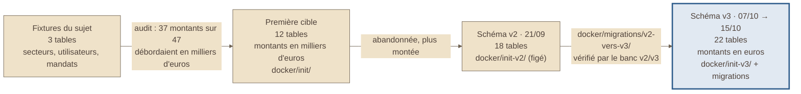

# Schéma 1 — d'où on part, où on arrive

> Tiré de la présentation du 2026-10-16 (schéma 1). Comptes de tables
> revérifiés le 2026-11-02 dans le dépôt **Fil-Rouge-API** (`docker/`).

## À quoi il sert

Montrer en un coup d'œil comment la base a grandi : des fixtures reçues
avec le sujet jusqu'au schéma v3 monté aujourd'hui.

## Le schéma

## Comment le lire

- De gauche à droite : le temps.
- 🔵 La boîte bleue est la **seule version montée** aujourd'hui : le schéma v3.
- Le schéma v2 est **figé** : il ne sert plus qu'au banc de migration.
- Le banc `API/tests/integration/test_banc_v2_v3.py` migre une base v2 et la
  compare au schéma v3, à chaque lancement des tests.

## Sources

- Comptes de `CREATE TABLE` : `docker/init/` (12), `docker/init-v2/` (18),
  `docker/init-v3/01_create_fil_rouge_immobilier.sql` (22).
- « 37 montants sur 47 » : repris de la présentation, pas recompté ici.
- Montants en euros : ADR-032.
