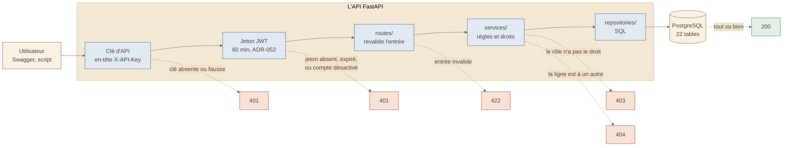

# Schéma 2 — le trajet d'une requête dans l'API

> Tiré de la présentation du 2026-10-16 (schéma 2), complété le 2026-11-02 :
> la clé d'API et le refus `401` manquaient. Vérifié dans **Fil-Rouge-API**
> (`API/src/app/`).

## À quoi il sert

Dire où une requête peut être arrêtée, et quel code de réponse le montre.

## Le schéma

## Comment le lire

- La requête va de gauche à droite. Chaque couche peut l'**arrêter**.
- 🟥 Les cases rouges sont les refus. Le **code** dit où elle s'est arrêtée.
- **401** : le même message dans tous les cas, exprès, pour ne rien
  révéler (ADR-052).
- **403** : les droits se vérifient d'abord **par rôle**, table par table
  (ADR-027). Les 5 rôles : Admin, Client, Hunter, Manager, Reader.
- **404** : le rôle a le droit, mais la ligne appartient à un autre. On
  répond comme si elle n'existait pas : un 403 dirait qu'elle existe.
- Chaque couche a un seul métier : les routes parlent HTTP, les services
  portent les règles, les repositories parlent SQL.

## Sources

- Clé d'API : `utils/api_keys.py` (`require_api_key`, en-tête `X-API-Key`).
- Jeton : `utils/current_user.py` (`get_current_user`) ; il relit le compte
  en base à chaque appel et refuse un compte non activé.
- Revalidation à la route : ADR-036.
