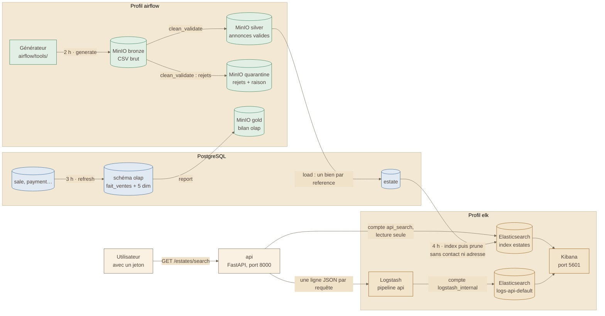

# Schéma 3 — le chemin des données

> Tiré de la présentation du 2026-10-16 (schéma 3). C'est la **vue
> d'ensemble**. Le détail, avec les noms exacts des fichiers MinIO et des
> tâches, est dans [`md/flux/schema-du-flux.md`](../../md/flux/schema-du-flux.md) :
> en cas d'écart, c'est lui qui fait foi.

## À quoi il sert

Suivre les données : de l'import de nuit jusqu'à la recherche, et des
requêtes de l'API jusqu'aux tableaux de bord.

## Le schéma

## Comment le lire

- 🟩 Vert : le profil `airflow`. 🟦 Bleu : la base. 🟧 Ocre : le profil `elk`.
- Trois traitements de nuit, chacun à son heure :
  - **2 h** · `annonces_import` : le CSV brut → bronze → silver ou
    quarantine → la table `estate` ;
  - **3 h** · `olap_refresh` : les tables du métier → le schéma `olap` ;
  - **4 h** · `estates_index` : `estate` → l'index de recherche.
- Rien ne se perd en silence : un rejet part en **quarantine**, avec sa raison.
- Les logs ne gardent **ni e-mail ni mot de passe**.

## Sources

- La présentation du 2026-10-16 (`md/equipe/2026-10-16-presentation.md`).
- Les ADR 059 à 064 (`md/adr/`).
