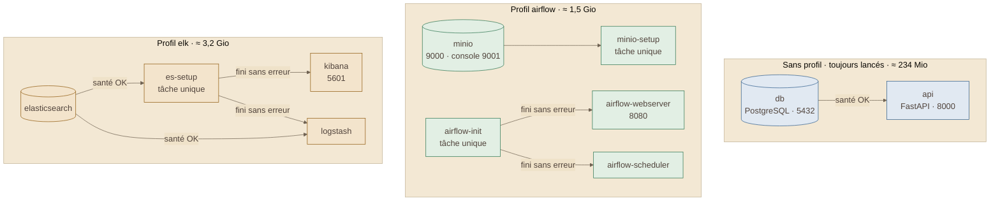

# Schéma 4 — la pile Docker, et ce qu'elle coûte

> Tiré de la présentation du 2026-10-16 (schéma 4), complété le 2026-11-02
> avec les ports et l'ordre de démarrage, lus dans
> `Fil-Rouge-API/docker/docker-compose.yml`.

## À quoi il sert

Savoir quels conteneurs existent, lesquels lancer, et dans quel ordre ils
démarrent.

## Le schéma

## Comment le lire

- **11 conteneurs**, rangés en **3 groupes** : on ne lance que ce dont on a
  besoin.
- Une flèche = « attend que l'autre soit prêt » (`depends_on`).
- « Tâche unique » : le conteneur prépare quelque chose, puis s'arrête.
- Le port affiché est celui ouvert sur la machine (`localhost:<port>`).

## Ce qu'elle coûte en mémoire

| Ce qu'on lance | Mémoire au repos |
|---|---|
| base + API seules | ≈ **234 Mio** |
| + profil `airflow` | ≈ **1,7 Gio** |
| + profil `elk` (tout) | ≈ **5,0 Gio** |

- Mesuré le 2026-10-15 vers 16 h 30 avec `docker stats --no-stream` :
  234,3 Mio (base), 1 552,2 Mio (airflow), 3 309,3 Mio (elk).
- Conseil : donner **6 Go** à Docker quand tout tourne.

## Sources

- `docker/docker-compose.yml` : services, `profiles`, `ports`, `depends_on`.
- Comment lancer chaque profil : [`md/equipe/tuto-lancer-la-pile.md`](../../md/equipe/tuto-lancer-la-pile.md).
