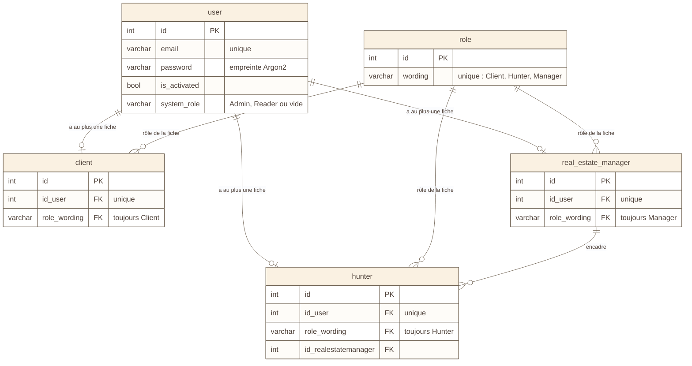

# Schéma 5 — les données : comptes et fiches

> Nouveau le 2026-11-02 : il manquait. Le modèle des 22 tables est coupé en
> trois schémas (5, 6, 7) pour rester lisible. Lu dans
> `Fil-Rouge-API/docker/init-v3/01_create_fil_rouge_immobilier.sql`, qui fait
> foi.

## À quoi il sert

Montrer qui est qui : un **compte** (`user`) pour se connecter, et une
**fiche** par métier (client, chasseur, manager), liée à ce compte.

## Le schéma

## Comment le lire

- `||--o|` : un compte a **zéro ou une** fiche de chaque sorte (`id_user`
  est unique dans chaque fiche).
- `||--o{` : un manager encadre **zéro, un ou plusieurs** chasseurs.
- Les **5 rôles** viennent de deux endroits :
  - **Client, Hunter, Manager** : la fiche, par `role_wording` → `role.wording` ;
  - **Admin, Reader** : le compte lui-même, par `user.system_role`.
- Le rôle d'une fiche est **figé** par un `CHECK` : une fiche client ne
  peut pas devenir chasseur (ADR-057, chantier PRF).
- Un compte non activé (`is_activated` faux) ne peut pas se connecter.
- Seules les clés et quelques colonnes utiles sont dessinées. Le reste est
  dans le fichier SQL.

## Sources

- `01_create_fil_rouge_immobilier.sql` : `role` (l. 163), `user` (juste
  après), `client` (l. 209), `real_estate_manager` (l. 262), `hunter` (l. 286).
