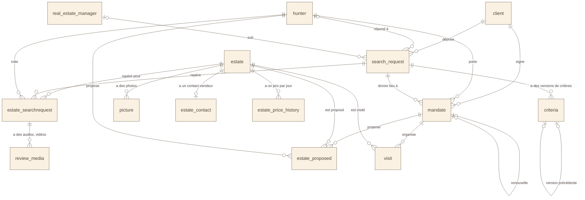

# Schéma 6 — les données : de la recherche au mandat

> Nouveau le 2026-11-02 : il manquait. Deuxième des trois schémas du modèle
> (5, 6, 7). Lu dans
> `Fil-Rouge-API/docker/init-v3/01_create_fil_rouge_immobilier.sql`, qui fait
> foi.

## À quoi il sert

Suivre le parcours d'un client : sa **demande**, ses **critères**, le
**mandat** confié à un chasseur, puis les **biens** proposés et visités.

## Le schéma

## Comment le lire

- `||--o{` : « un … pour zéro, un ou plusieurs … ».
- `|o--o{` : le côté gauche est **facultatif** (la colonne peut être vide).
- `|o--o|` : zéro ou un, des deux côtés.
- Le parcours se lit de haut en bas :
  1. le client dépose une **demande** (`search_request`) ;
  2. ses **critères** sont versionnés : on garde chaque version (`criteria`) ;
  3. un **mandat** lie le client, un chasseur et la demande ;
  4. le chasseur **repère** des biens et les note (`estate_searchrequest`) ;
  5. il en **propose** au client (`estate_proposed`), qui les **visite** (`visit`).
- Des clés doubles verrouillent la cohérence. Exemple : un bien proposé doit
  l'être par **le chasseur du mandat** (`fk_proposed_hunter_of_mandate`).

## Sources

- `01_create_fil_rouge_immobilier.sql` : `search_request` (l. 392),
  `criteria` (l. 418), `mandate` (l. 546), `estate` (l. 709), `picture`
  (l. 799), `estate_contact` (l. 812), `estate_price_history` (l. 846),
  `estate_searchrequest` (l. 866), `review_media` (l. 881),
  `estate_proposed` (l. 891), `visit` (l. 928).
- Liens vers `user` (auteurs : `id_author`) non dessinés, pour rester lisible.
