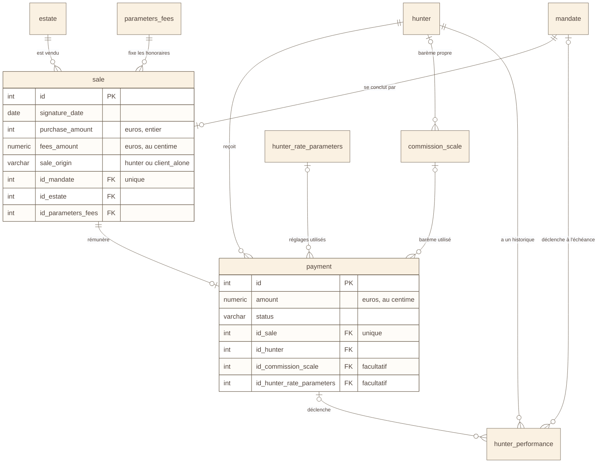

# Schéma 7 — les données : vente et rémunération

> Nouveau le 2026-11-02 : il manquait. Troisième des trois schémas du
> modèle (5, 6, 7). Lu dans
> `Fil-Rouge-API/docker/init-v3/01_create_fil_rouge_immobilier.sql`, qui fait
> foi.

## À quoi il sert

Montrer ce qui se passe quand un bien est acheté : la **vente**, puis le
**paiement** du chasseur, calculé avec des paramètres datés.

## Le schéma

## Comment le lire

- Une **vente** par mandat au plus (`id_mandate` unique).
- Un **paiement** par vente au plus (`id_sale` unique).
- Le paiement garde **les paramètres utilisés** pour le calculer : on peut
  toujours refaire le calcul, même si les paramètres changent ensuite.
- `hunter_performance` garde l'historique du taux de réussite du chasseur.
  Une ligne naît d'un paiement, d'un mandat échu, ou au départ
  (`trigger_type` : `payment`, `mandate_expired`, `initial`).
- Montants : prix en **euros entiers**, honoraires et paiements **au
  centime** (règle 4 du `CLAUDE.md`).
- Le calcul lui-même : `services/remuneration.py`, branché par
  `POST /sales/{id}/payment`.

## Sources

- `01_create_fil_rouge_immobilier.sql` : `parameters_fees` (l. 962), `sale`
  (l. 975), `commission_scale` (l. 1014), `hunter_rate_parameters`
  (l. 1065), `payment` (l. 1103), `hunter_performance` (l. 1246).
- La traçabilité du calcul : [`md/regles-metier/schema-tracabilite-remuneration-chasseur_v4.md`](../../md/regles-metier/schema-tracabilite-remuneration-chasseur_v4.md).
