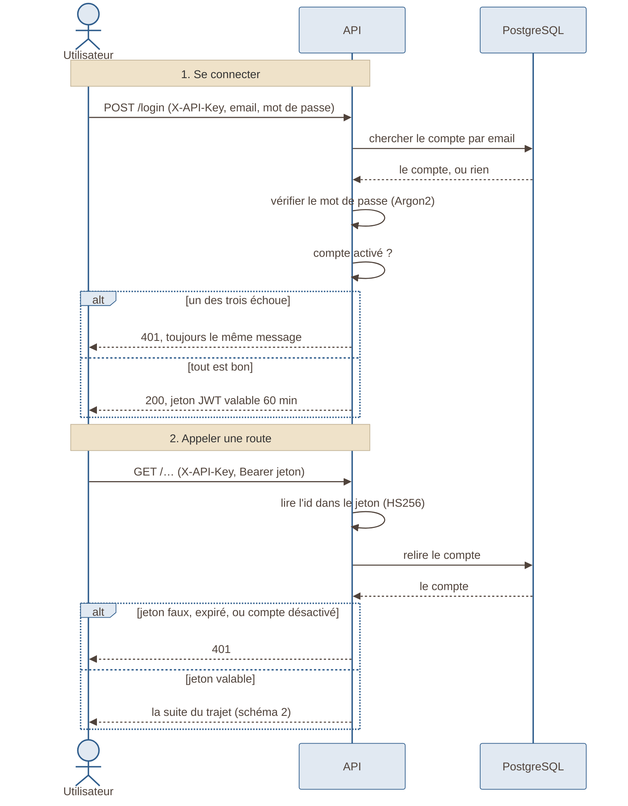

# Schéma 8 — se connecter et utiliser son jeton

> Nouveau le 2026-11-02 : il manquait. Lu dans le code de
> **Fil-Rouge-API** : `routes/auth_router.py`, `services/user_service.py`,
> `utils/security.py`, `utils/current_user.py`.

## À quoi il sert

Montrer, dans l'ordre, ce qui se passe quand on se connecte, puis quand on
appelle une route avec son jeton.

## Le schéma

## Comment le lire

- Deux clés, deux rôles :
  - la **clé d'API** (`X-API-Key`) dit **quel programme** appelle ;
  - le **jeton** (JWT) dit **quelle personne** appelle.
- Le jeton ne porte **que l'id du compte** : ni e-mail, ni rôle.
- Le compte est **relu en base à chaque appel** : un compte désactivé est
  refusé tout de suite, même avec un jeton encore valable.
- Un email inconnu prend **le même temps** qu'un mauvais mot de passe : on
  ne peut pas deviner quels emails existent.
- Pas de jeton de rafraîchissement : après 60 minutes, on se reconnecte.

## Sources

- `routes/auth_router.py` : `login`, `me`.
- `services/user_service.py` : `authenticate`.
- `utils/security.py` : Argon2, `JWT_ALGORITHM = "HS256"`,
  `ACCESS_TOKEN_TTL = timedelta(minutes=60)`.
- `utils/current_user.py` : `get_current_user`.
- Décisions : ADR-028 (clé d'API), ADR-052 (jeton), ADR-016 (Argon2).
