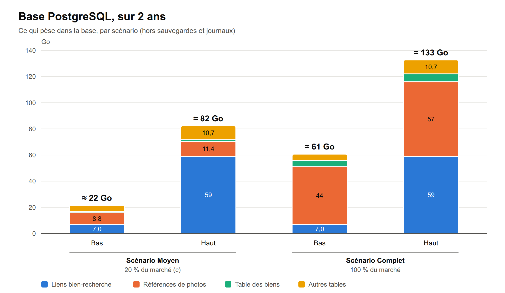
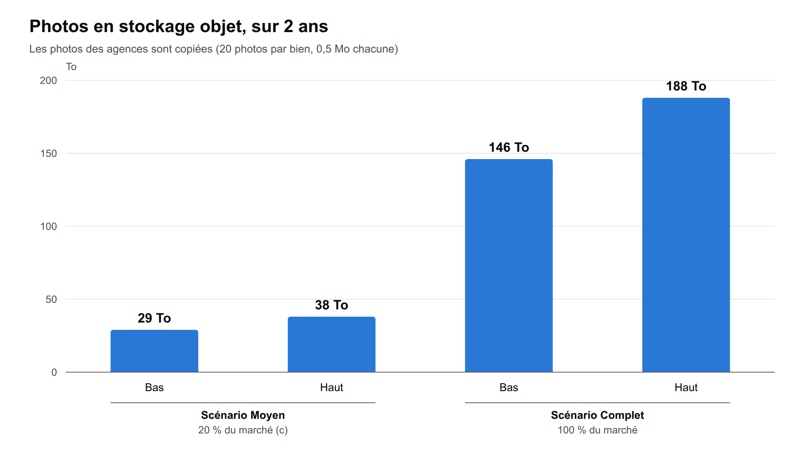

# Note de dimensionnement 3V

> Gabriel Capelli, 15 oct. 2026 ; version courte du 2026-11-20. Le détail (13 hypothèses, 14 calculs, 14 sources et leur statut de vérification) est en annexe : [`note-dimensionnement-3v-complete.md`](../../md/equipe/note-dimensionnement-3v-complete.md) ; les graphiques, dans [`annexes/dimensionnement-3v/`](annexes/dimensionnement-3v/).

## 1. La question

Après l'expansion (France et 9 pays européens, d'après le sujet), **combien de données** le système devra-t-il tenir, **à quelle vitesse** arrivent-elles, et **sous quelles formes** ? Horizon : **2 ans** de production.

Le catalogue de biens est alimenté en lisant automatiquement les sites des agences (*scraping*). Les photos des annonces ne sont **pas copiées** : on garde seulement leur adresse (URL) sur le site de l'agence.

## 2. Les hypothèses qui comptent

| Hypothèse | Bas | Haut | D'où elle vient |
| --- | --- | --- | --- |
| Mandats par semaine | 2 000 | 5 000 | sujet : « plusieurs milliers » ; bornes choisies par l'équipe |
| Biens trouvés par recherche | 300 | 1 000 | sujet : « plusieurs centaines, voire milliers » |
| Ventes du marché par an (10 pays) | 5,2 M | 5,2 M | Insee pour la France (958 000), étendu aux 10 pays par la population |
| Biens mis en vente pour une vente | 1,4 | 1,8 | flux des portails immobiliers |
| Liens de photos par bien | 20 | 20 | choix de l'équipe |

Deux façons de remplir le catalogue : **Moyen** (20 % du marché, à confirmer) et **Complet** (tout le marché).

## 3. Volume : de 22 à 133 Go en 2 ans

| | Moyen, Bas | Moyen, Haut | Complet, Bas | Complet, Haut |
| --- | --- | --- | --- | --- |
| Liens bien-recherche | 7 Go | 59 Go | 7 Go | 59 Go |
| Liens de photos | 8,8 Go | 11,4 Go | 44 Go | 57 Go |
| Biens et autres tables | 5,7 Go | 11,9 Go | 9,7 Go | 16,7 Go |
| **Total de la base PostgreSQL** | **≈ 22 Go** | **≈ 82 Go** | **≈ 61 Go** | **≈ 133 Go** |
| Photos copiées | 0 | 0 | 0 | 0 |

- C'est un **majorant** : un bien n'est stocké qu'une fois, et le nombre de biens est plafonné par le marché.
- **Deux tables font 84 à 87 % du volume** (scénario Complet) : les liens entre biens et recherches, et les liens de photos.
- Non compté : journaux, sauvegardes et fragmentation, qui multiplient couramment la taille par 2 à 3 (jusqu'à 270-400 Go pour le Complet Haut).

## 4. Vélocité : le scraping est le flux le plus rapide

| Flux (moyenne) | Bas ou Moyen | Haut ou Complet |
| --- | --- | --- |
| Nouveaux mandats par jour | 285 | 712 |
| Nouveaux biens par jour | 4 000 à 5 200 | 20 000 à 25 800 |
| Pages d'agences relues par seconde (une fois par jour et par bien) | 9 à 11 | 46 à 56 |

- Le rafraîchissement du catalogue décide du nombre de machines de scraping. Les écritures en base, elles, restent faibles (4,6 à 6 liens de photos par seconde).
- ⚠️ Ce sont des **moyennes** : aucun pic n'est chiffré.

## 5. Variété

- **Trois formes** : structuré (mandats, ventes, paiements), semi-structuré (annonces de milliers de sites différents), non structuré (photos, avis audio et vidéo).
- **10 pays** : langues, formats de code postal et classes énergétiques différents ; tous les montants en euros.
- **Doublons** : un même bien publié par plusieurs agences doit être reconnu **avant** d'enregistrer ses photos.
- **Qualité mesurée** : 55 % des cellules remplies dans les 2 556 annonces brutes, 70 % après normalisation ([note de qualité](3.7-note-qualite-donnees.md)).

## 6. Ce qu'on en conclut pour l'architecture

- **Une seule instance PostgreSQL suffit** pour 22 à 133 Go (appréciation, non mesurée sous charge).
- Les deux grosses tables de liens sont les **premières à partitionner**, et leurs identifiants passent en entiers longs (`BIGINT`) : un entier simple serait épuisé en 8 à 11 ans dans le scénario Haut.
- Le scraping demande un **orchestrateur et plusieurs machines** de collecte (Airflow).
- **Lier les photos plutôt que les copier** évite de 29 à 188 To de stockage. Décision du groupe (15 oct. 2026) : aucune obligation de les stocker n'est connue, et les copier en masse expose à un litige (droit d'auteur).

## 7. Limites

- La couverture « Moyen » (20 %) et le passage de la France aux 10 pays (par la population) sont des **choix non vérifiés**.
- Le recoupement entre recherches et les doublons entre agences ne sont pas chiffrés : le flux brut de scraping est **sous-estimé**.
- Une photo retirée par l'agence casse le lien : il faut contrôler les liens régulièrement.
