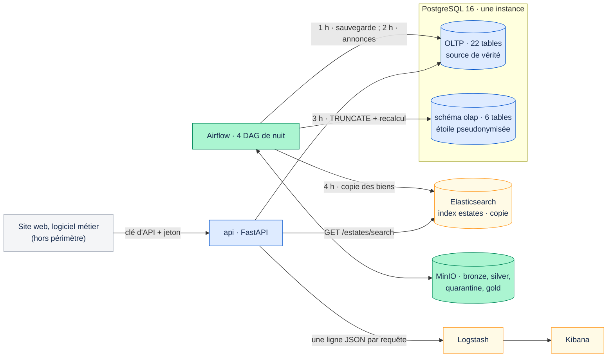

# Dossier d'architecture — absorber la croissance

> Version courte du 2026-11-20 ; version complète en
> [annexe](../../md/equipe/dossier-architecture-complete.md). Phase 3, BC01 :
> 1 schéma de composants, 1 matrice de décision, 2-3 pages.
>
> Statuts : ✅ établi (lu dans le code ou mesuré) · 🟡 à décider · 💡 proposé ·
> ⚠️ limite connue.

## 1. Le besoin

Le sujet demande de dimensionner pour la croissance (France, DROM et 9 pays)
et de **séparer le transactionnel de l'analytique**. La [note 3V](3.1-note-dimensionnement-3v.md) chiffre la cible :
de **22 à 133 Go** de base après 2 ans, **285 à 712** nouveaux mandats par
jour, et un scraping de **9 à 56 pages par seconde** (§ 3 et § 4).

## 2. Les composants

Détail : [04 — la pile Docker](annexes/schema-pile-docker.md) (11 conteneurs, 3 profils)
et [03 — le chemin des données](annexes/schema-chemin-des-donnees.md).

Un DAG est un traitement planifié d'Airflow ; MinIO stocke les fichiers du flux.

| Composant | Point de performance | Source |
|---|---|---|
| `api` (FastAPI) | ⚠️ connexion : argon2 (hachage des mots de passe) à **512 Mo et ~298 ms par essai** ; freinée depuis le 2026-11-19 (5 échecs par email ou 20 par IP en 15 min → `429`) | `utils/security.py:45` |
| | ⚠️ le compte est relu en base à **chaque** appel | ADR-052 (droits relus à chaque appel) |
| | ⚠️ pas de pagination : `GET /estates` rend tous les biens (3 219 en dev : 1,25 s, mesuré le 2026-11-20) | `API/README.md` |
| PostgreSQL, OLTP | ✅ **7 index** posés à la main, dont 3 le 2026-11-19 après mesure (× 15 à × 100, [note d'indexation](../2-modelisation/2.8-note-indexation.md)) ; ⚠️ les autres clés étrangères n'ont pas d'index dédié ; **0** table partitionnée | `init-v3/01_create_fil_rouge_immobilier.sql` |
| PostgreSQL, `olap` | ✅ précalculé : l'analyse ne refait pas les jointures du métier ; ⚠️ recalcul **complet** chaque nuit, 0 index | `airflow/src/olap/load.py` |
| Elasticsearch | ✅ arrêté, seule la recherche répond `503` ; ⚠️ 1 shard, 0 réplique, jusqu'à 24 h de retard | ADR-061 (recherche en copie) |
| Airflow | ⚠️ une seule machine : ne tiendra pas 9 à 56 pages par seconde | ADR-059 (choix d'Airflow) |
| MinIO | ✅ un rejet garde sa raison (`quarantine`) ; ⚠️ aucune réplication | ADR-060 (stockage MinIO) |
| Logstash, Kibana | ✅ hors du chemin des requêtes : arrêtés, ils ne bloquent pas l'API | `docker/logstash/` |

Mémoire et volet green IT : 234 Mio pour `db` et `api` seuls, 5,0 Gio avec
tous les profils ; le détail est dans la
[note d'environnement technique](3.6-note-environnement-technique.md).

## 3. Comparer les architectures

### 3.1 OLTP et OLAP : pourquoi les séparer

OLTP : la base du métier, faite pour beaucoup de petites écritures. OLAP : une
copie faite pour l'analyse, avec de gros calculs en lecture.

| | OLTP (le métier) | OLAP (l'analyse) |
|---|---|---|
| Question type | « ce mandat est-il signé ? » | « commission moyenne par secteur et par trimestre ? » |
| Forme | 22 tables normalisées, contraintes fortes | une étoile : `fait_ventes` + 5 dimensions |
| Écritures | à chaque action d'un utilisateur | une fois par nuit |
| Données personnelles | oui, nominatives | non : des numéros et des attributs non identifiants |
| Fraîcheur | immédiate | au plus une nuit de retard |

Séparer les deux protège le métier des requêtes lourdes ; l'analyse, demain
l'IA, lit une vue **sans nom ni contact** ([schéma OLAP](3.4-olap.md)).

### 3.2 Le choix

La [matrice de décision](3.3-matrice-decision-architecture.md) compare quatre
options sur six critères pondérés : base unique (**77**/120), **OLTP + OLAP
dans la même instance (92)**, entrepôt séparé (81), microservices (65).

✅ **Retenue : B, OLTP + OLAP dans la même instance.** Les arbitrages qu'elle
coûte sont dans la matrice, § 4.

## 4. Les leviers de la croissance

Le sujet en nomme quatre. Chacun a son moment, fixé par la note 3V.

| Levier | Ce qu'il résout | Aujourd'hui | Quand l'activer | Statut |
|---|---|---|---|---|
| **Indexation** | une lecture qui parcourt toute la table | 7 index | **Maintenant** : clés étrangères jointes (`id_search_request`, `id_mandate`, `id_estate`, `id_hunter`, `id_client`) et filtres du matching (`estate.town`, `estate.price`, `estate.estate_type`), vérifiés par `EXPLAIN ANALYZE` (plan d'exécution mesuré) avant et après | ✅ 3 posés et mesurés · 💡 les autres |
| **Partitionnement** (couper une table en morceaux) | une table si grosse que l'entretien et les lectures ralentissent | 0 table partitionnée | Quand les deux tables de liens dépassent quelques dizaines de Go : elles font **84 à 87 %** du volume (scénario Complet). Par mois de création, ou par pays | 🟡 |
| **Réplication** (une copie à jour sur une autre machine) | une panne de la seule instance ; des lectures qui saturent | aucune | **Avant la mise en production** : une réplique en lecture, promue si l'instance tombe. Elle tient aussi le temps de reprise à 133 Go | 💡 voir [PCA/PRA](3.5-pca-pra-plan-de-migration.md) § 4 |
| **Sharding** (répartir les données sur plusieurs machines) | un volume qu'une machine ne tient plus | aucun | **Pas avant longtemps** : 133 Go tiennent sur une instance. Sinon, par pays | 🟡 écarté pour l'instant |

Deux changements suivent le volume :
- 💡 **Identifiants en `BIGINT`** sur les deux tables de liens : un `INTEGER`
  plafonne à 2,1 milliards, atteint en 8 à 11 ans dans le scénario Haut (note
  3V § 6).
- 💡 **OLAP incrémental** : recalculer la seule veille, quand la nuit ne
  suffira plus (durée du recalcul pas encore mesurée).

## 5. Sécurité et éco-conception

**Sécurité** (détail : [note de sécurité applicative](../4-application/4.5-note-securite-applicative.md))
- Deux contrôles à chaque appel : la clé dit quel programme appelle, le jeton
  quelle personne agit (ADR-028).
- Un compte technique par usage, chacun limité à son besoin (ADR-061,
  ADR-027 : rôle en lecture seule).
- L'index et l'OLAP ne contiennent ni contact du vendeur, ni rue, ni nom.

**Éco-conception** (détail : [note d'éco-conception](../5-transverse/5.2-note-eco-conception.md))
- Quatre traitements **par nuit**, pas en continu.
- Les photos des agences sont **liées, pas copiées** : de 29 à 188 To de
  stockage évités (note 3V § 6).

## 6. Limites, à dire au jury

- ⚠️ Une seule instance de chaque service : `db` et `api` redémarrent seuls
  après un plantage, mais rien ne bascule sur une autre machine (voir le PCA/PRA).
- ⚠️ Les leviers du § 4 sont **conçus, pas éprouvés** : une mesure de charge
  sur un poste de dev (note d'environnement § 5), et la note d'indexation.
- ⚠️ Airflow 2.11.2 est en fin de vie depuis avril 2026 (ADR-059).
- 🟡 Le seuil où l'entrepôt séparé devient nécessaire n'est pas chiffré.

**Au jury, en une phrase** : « Le métier et l'analyse sont séparés dans la
même base, l'analyse sans données personnelles ; la recherche est une copie
jetable ; chaque levier de croissance a son déclencheur chiffré. »
