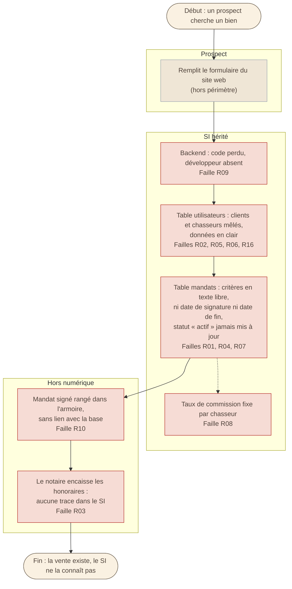
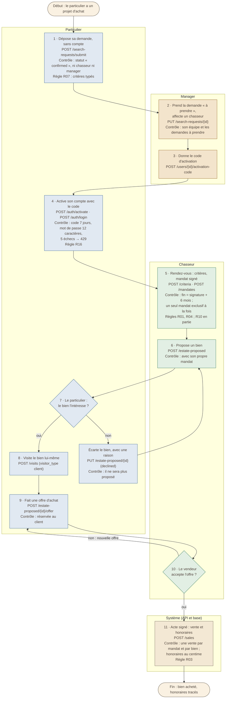
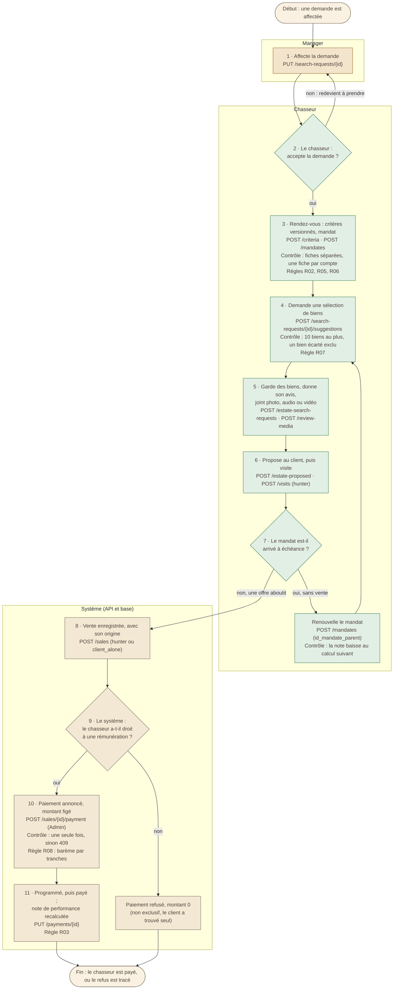

# Processus métier — de l'existant au système cible

> Compétence : « Schématiser les processus métier en tenant compte des contraintes, de l'existant et des vulnérabilités » — schémas de processus, du parcours utilisateur au processus système (`documents utiles/TRACABILITE-COMPETENCES.md:49` et `:62`, StarterPack). Phases 2 à 4.
> Version 2 du 2026-11-19, rédigé avec l'assistant IA du projet après la relecture de Gabriel (v1 : l'existant n'était pas dessiné, les failles et les contraintes n'étaient pas sur le schéma, des chemins manquaient).
> Sources : le `Readme.md` du sujet (les parcours), l'audit de la phase 1 (`livrables/1-audit/`, failles `R01` à `R16`), les user stories (`user-stories/01` à `07`), le schéma v3 (valeurs des statuts, `docker/init-v3/01_create_fil_rouge_immobilier.sql`) et les routes réelles de l'API (`GET /openapi.json`, `Fil-Rouge-API`, 2026-11-19).
> Images : [`images/processus-existant.png`](images/processus-existant.png), [`images/processus-particulier.png`](images/processus-particulier.png), [`images/processus-chasseur.png`](images/processus-chasseur.png).

**Comment lire.**
- Un couloir par acteur. Un ovale marque le **début** ou la **fin** ; un losange, une **décision** (le couloir dit qui décide).
- Sur chaque étape, la ligne **« Contrôle »** dit la contrainte qui s'y applique, et la ligne **« Règle »** la faille de l'audit qu'elle corrige.
- Toute requête passe d'abord par les contrôles de l'API : clé et jeton (`401`), entrée valide (`422`), rôle autorisé (`403`), « le sien » (`404`). Ils ne sont pas répétés sur chaque étape.

---

## 1. L'existant, au 25/07/2026

Ce que montre l'existant : rien ne relie la demande, le mandat signé, la vente et les honoraires. Chaque flèche passe par une faille ; la cible les ferme une à une.

---

## 2. Le parcours cible du particulier

---

## 3. Le parcours cible du chasseur

---

## 4. De l'existant à la cible : chaque faille, et l'étape qui la ferme

| Faille de l'audit | Dans l'existant | Étape cible qui la ferme |
|---|---|---|
| R01 statut « actif » faux | jamais mis à jour | particulier 5, chasseur 7 : la fin est calculée et contrôlée ; le renouvellement crée un nouveau mandat lié à l'ancien |
| R02, R05, R06 rôles mêlés | une seule table | chasseur 3 : une fiche par rôle, un compte n'en a qu'une |
| R03 honoraires sans trace | chez le notaire seulement | particulier 11, chasseur 8 à 11 : vente, honoraires, paiement |
| R04 pas de date de fin | absente | particulier 5 : fin = signature + 6 mois |
| R07 critères en texte libre | « T3 Ecusson, budget… » | particulier 1, chasseur 3-4 : critères typés et versionnés, lus par le moteur |
| R08 taux fixe | un taux par chasseur | chasseur 10 : barème par tranches, ancienneté, performance |
| R09 code perdu | backend sans source | toutes : une API sur GitHub, couverte par 1 120 tests |
| R10 armoire papier | aucun lien | **en partie**, particulier 5 : le mandat est en base, avec sa date et son mode de signature (`paper` ou `electronic`) ; le document papier reste dans l'armoire, sa numérisation est prévue plus tard (ADR-065) |
| R16 données en clair | sans droits | particulier 4 : comptes et droits par rôle ; « le sien » sur chaque lecture |

---

## 5. Limites connues

- **La sélection n'est pas quotidienne** : le chasseur la demande (étape 4) ; aucune tâche planifiée ne la lance chaque jour (backlog, Should).
- **L'échéance du mandat n'est pas détectée seule** : le renouvellement se fait à la main, et la note baisse au calcul suivant (backlog, Should).
- **Hors périmètre** : les notifications (le code d'activation remplace l'email), la facture (Product Owner, 07/10), le notaire (sa date et son prix sont des entrées du calcul), l'IA générative (user stories 08 et 09, conçues dans `schema-programme-ia.md` et `conception-matching-features.md`).
