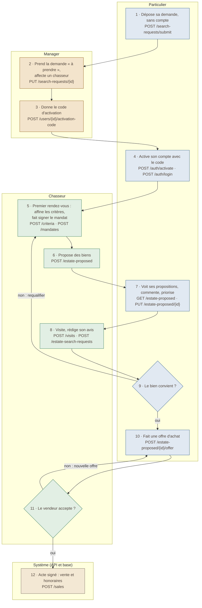
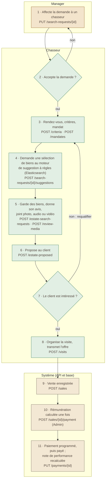

# Processus métier — du parcours au système

> Compétence : « Schématiser les processus métier en tenant compte des contraintes, de l'existant et des vulnérabilités » — schémas de processus, du parcours utilisateur au processus système (`documents utiles/TRACABILITE-COMPETENCES.md:49` et `:62`, StarterPack). Phases 2 à 4.
> Rédigé le 2026-11-19 par le Glaude, à la demande de Gabriel. Sources : le `Readme.md` du sujet (les parcours), les user stories (`user-stories/01` à `07`), et les routes réelles de l'API (`GET /openapi.json`, `Fil-Rouge-API` au commit `31094a8`).
> Images : [`images/processus-particulier.png`](images/processus-particulier.png), [`images/processus-chasseur.png`](images/processus-chasseur.png), rendues depuis le Mermaid ci-dessous.

**Comment lire.** Un couloir par acteur. Chaque étape porte la **route de l'API** qui la réalise. Les losanges sont des décisions. Sous chaque schéma, un tableau donne pour chaque étape la **contrainte** qui s'applique, ce que faisait **l'existant**, et la **faille de l'audit** qu'elle règle (`R01` à `R16`, `livrables/1-audit/02-registre-anomalies-risques.md`).

---

## 1. Le parcours du particulier

| # | Contrainte qui s'applique | L'existant | Faille réglée |
|---|---|---|---|
| 1 | aucun compte exigé ; la demande part « à prendre » (ni chasseur ni manager) | le site web écrivait les critères en texte libre | R07 |
| 2 | le manager ne voit que son équipe et les demandes « à prendre » | aucune affectation tracée | — |
| 3-4 | code valable 7 jours, à usage unique ; mot de passe de 12 caractères au moins ; 5 échecs par email → `429` | aucun compte client | R16 |
| 5 | fin = signature + 6 mois, contrôlée par la base ; un seul mandat exclusif à la fois ; critères versionnés | mandat papier dans l'armoire ; statut « actif » faux ; aucune date de fin | R01, R04, R10 |
| 6-7 | le particulier ne voit **que ses** propositions (la ligne d'un autre rend `404`) ; un bien écarté n'est plus proposé | rien : aucun bien en base | R03, R16 |
| 8 | une visite s'enregistre une fois faite, pendant la durée du mandat | rien | — |
| 10-11 | seul le client fait l'offre ; après un refus du vendeur, une nouvelle offre reste possible | rien | — |
| 12 | une seule vente par mandat et par bien ; honoraires en euros au centime (`NUMERIC(12,2)`) | les honoraires n'existaient nulle part | R03 |

---

## 2. Le parcours du chasseur

| # | Contrainte qui s'applique | L'existant | Faille réglée |
|---|---|---|---|
| 1-2 | un refus rend la demande « à prendre » ; le chasseur ne voit que ses demandes | aucune affectation tracée | — |
| 3 | un chasseur et un client sont deux fiches séparées ; un compte n'a qu'une fiche (3 triggers) | un chasseur enregistré comme client du mandat 13 | R02, R05, R06 |
| 4 | suggestions limitées à 10 biens, classées par pertinence ; un bien écarté n'est plus proposé | les critères en texte libre, illisibles par une machine | R07 |
| 5 | l'avis peut être un texte seul ; les médias ont leur propre table | rien | — |
| 7 | à noter : la sélection **chaque jour** n'est pas planifiée : le chasseur la demande (backlog, Should) | rien | — |
| 9 | une seule vente par mandat et par bien | les ventes n'existaient pas | R03 |
| 10 | calcul du sujet (barème par tranches, ancienneté, performance) ; un second appel rend `409` | un taux fixe par chasseur | R08 |
| 11 | le montant annoncé est figé jusqu'au paiement ; un refus met le montant à 0 | aucune trace du paiement | R03 |

---

## 3. Ce que les schémas ne montrent pas

- **Les notifications** (email, alerte) : hors périmètre ; le code d'activation remplace l'email de bienvenue (backlog, Won't).
- **La facture** : hors périmètre (Product Owner, 07/10).
- **Le notaire** : l'acte n'est pas géré ; sa date et son prix sont des entrées du calcul.
- **Le futur avec l'IA** (user stories 08 et 09) : conçu dans `schema-programme-ia.md` et `conception-matching-features.md`, pas codé.
