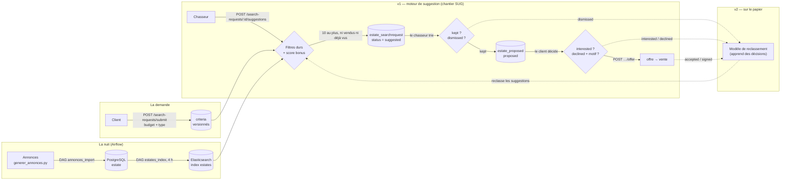

# Livrable 4 — Le schéma du programme d'IA

> Brouillon du 2026-11-03, à relire par l'équipe. Format attendu : « 1 schéma
> + description entrées/sorties » (`SP/documents utiles/GRILLE-EVALUATION.md:32`).
> Statuts : ✅ établi (codé ou voté) · 🟡 à décider · 💡 proposé.

## En une phrase

La machine **suggère**, le chasseur **trie**, le client **décide** — et chaque
décision devient, plus tard, la donnée qui apprendra au système les goûts réels.

## Le schéma

- Trait plein : ce qui existe ou se code dans le chantier SUG.
- Pointillés : la v2, conçue mais non codée.

## Ce qui entre, ce qui sort

| Étape | Entrée | Sortie | Statut |
|---|---|---|---|
| Import et index | annonces CSV | lignes `estate`, documents de l'index `estates` | ✅ codé (chantier FLX) |
| Dépôt de la demande | formulaire JSON du client | `search_request` + 1ʳᵉ version de `criteria` | ✅ voté, codé en SUG3 |
| Suggestion | dernière version de `criteria`, index `estates` | ≤ 10 lignes `estate_searchrequest` en `suggested` | ✅ voté, codé en SUG7 et SUG8 |
| Tri du chasseur | les `suggested` | `kept` ou `dismissed` | ✅ voté, codé en SUG4 |
| Décision du client | un bien proposé | `interested` ou `declined` + motif | ✅ voté, codé en SUG5 |
| Reclassement v2 | les décisions passées d'une demande | un ordre de pertinence | 💡 sur le papier |

## Les briques de l'énoncé, et où elles en sont

L'énoncé liste les assistances voulues (`SP/user-stories/09_futur_chasseur_assistance_ia.feature`).

| Scénario (ligne) | Ce que nous faisons |
|---|---|
| Sélection dédoublonnée et ordonnée par pertinence (l.34-40) | ✅ v1 : filtres + score ; la pertinence apprise viendra en v2 |
| Écarter les biens qui ressemblent aux biens rejetés (l.42-46) | 💡 v2 : vecteur par bien, recherche des plus proches (`dense_vector` + kNN d'Elasticsearch) |
| Offre sous le prix affiché pré-calculée (l.40, l.54-58) | 💡 feature « baisse de prix » tirée de `estate_price_history` |
| Rapport de faisabilité, prise de contact, avis pré-rédigés, facture, renouvellement (l.15-32, 48-71) | 🟡 hors périmètre de ce livrable |

## Les garde-fous

- **Le chasseur reste dans la boucle** : la machine écrit en `suggested`, jamais
  directement chez le client. Seul un bien `kept` se propose (règle P19 renforcée, SUG4).
- **Lecture seule** pour tout outil d'IA branché sur la base : le rôle
  `fil_rouge_reader` existe déjà (chantier LOT, LOT12).
- **Aucune donnée personnelle dans les features** : ni nom, ni âge, ni
  situation familiale. Le modèle juge un couple (demande, bien), pas une personne.
- Les droits propres du chasseur IA : ADR-058, **proposé**, pas encore codé (🟡).
- Le détail : la note souveraineté / sécurité IA, [`md/securite/note-souverainete-securite-ia.md`](../../md/securite/note-souverainete-securite-ia.md).
