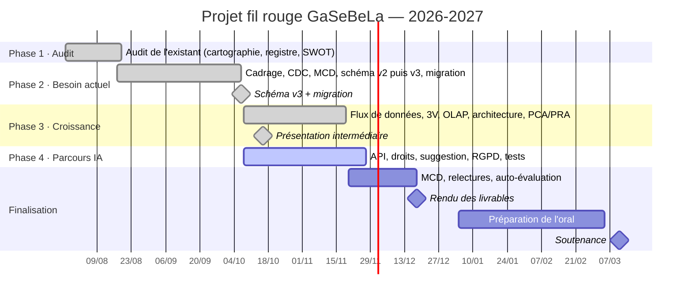

# 📅 Planning (Gantt) et jalons

> Livrable de pilotage (BC02) : « Planning (Gantt) + jalons — 1 schéma + légende » (`GRILLE-EVALUATION.md`).
> Première version du 2026-11-19, rédigée par le Glaude, proposée par Gabriel et à ajuster par le groupe. Hypothèse : **2 à 3 jours de travail par semaine**.
> Les dates viennent du projet lui-même (📜) : note de cadrage, pages Confluence, commits GitHub, chantiers clos. **Trois dates sont proposées** (💡), faute de date réelle.
> Image : [`images/gantt.png`](images/gantt.png), rendue depuis le Mermaid ci-dessous.

## Les jalons

| Jalon | Date | Source |
|---|---|---|
| Début du projet (1er commit) | 27/07/2026 | 📜 GitHub |
| Fin de l'audit | 19/08/2026 | 📜 dernière page de phase 1 (SWOT, 19/08) |
| Note de cadrage v1 | 21/08/2026 | 📜 note de cadrage, § 10 |
| ADR-018 et ADR-019 | 06/09/2026 | 📜 cahier des charges, § 12 |
| Schéma v2 (18 tables) | 21/09/2026 | 📜 présentation du 16/10 |
| **Schéma v3 + migration** | **07/10/2026** | 📜 chantier LOT clos |
| Flux de données | 15/10/2026 | 📜 chantier FLX clos |
| **Présentation intermédiaire** | **16/10/2026** | 📜 note de cadrage, § 6 |
| Suggestion de biens, RGPD | 03/11/2026 | 📜 chantiers SUG et RGP clos |
| Tests fonctionnels, dossier d'architecture | 19/11/2026 | 📜 commits du 19/11 |
| Fin de la phase 4 | 27/11/2026 | 💡 proposée |
| **Rendu des livrables** | **18/12/2026** | 💡 proposée |
| Début de la préparation de l'oral | 04/01/2027 | 💡 proposée |
| **Soutenance** | **11/03/2027** | 📜 Gabriel, 19/11 |

## Légende

- Vert : fini · orange : en cours · bleu : à venir · losange : jalon · ligne rouge : aujourd'hui (date du rendu de l'image).
- Les phases 1 et 2 se **chevauchent** (17 au 19/08) : on finissait l'audit en commençant le cadrage. Les phases 3 et 4 se mènent **en parallèle** depuis le 08/10.
- La note de cadrage (§ 6) disait « phase 1 du 25 au 31 juillet » : les pages de l'audit datent d'août (05/08 à 19/08), d'où la fin au 19/08.
