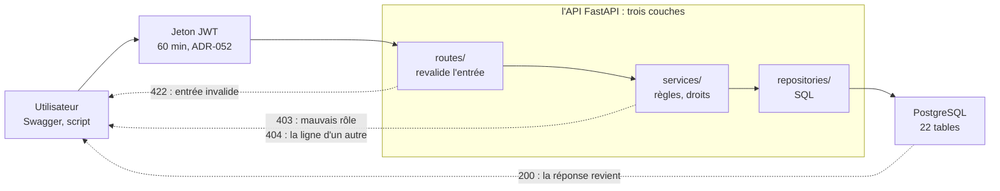
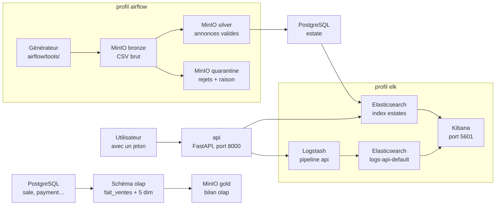

# Présentation GaSeBeLa : le plan des 20 minutes

> Écrit le 2026-10-15 au soir, pour la présentation aux autres groupes du
> **2026-10-16, 14 h 55 → 15 h 25**. Photo du jour : elle ne bouge plus.
> C'est la version texte de la page interactive
> [`2026-10-16-presentation.html`](2026-10-16-presentation.html)
> (à ouvrir dans un navigateur : chrono, schémas animés).
> En ligne : la [page de préparation](https://claude.ai/artifact/HbBT9ZTHPzbUPAfqEGusz2)
> et le [diaporama, 15 diapos](https://claude.ai/artifact/GKEKGnngY3jKKbTf7ekEK4)
> (export .pptx par Partager › Exporter).
> Sources : `TRAME-SOUTENANCE.md` et `Readme.md` du sujet ; dépôts Fil-Rouge
> et Fil-Rouge-API au 15/10 (API `3729719`) ; rapport de couverture du 15/10 ;
> ADR dans `md/adr/`.

Tout se discute : c'est une proposition, à trancher par l'équipe. Les
phrases « on a choisi… parce que… » sont à relire : c'est nous qui les
défendons.

## En bref

- **20 min** de présentation, puis **≈ 10 min** de questions.
- **5 parties**, dans l'ordre de la trame de soutenance du sujet.
- **4 voix** : Gabriel, Seb, Békanty, Laurence.
- **0 démo** : retirée par Seb, les schémas la remplacent.

Les autres groupes ont le même sujet : ils connaissent déjà le contexte.
**On passe vite sur le problème, et on prend du temps sur nos choix.**

## Les 20 minutes

| Partie | Durée | De … à | Voix proposée |
|---|---|---|---|
| 1. Le problème | 2 min | 0 → 2 min | Laurence |
| 2. La démarche | 3 min | 2 → 5 min | Gabriel |
| 3. Les choix clés | 9 min | 5 → 14 min | Gabriel et Seb |
| 4. Les transverses | 4 min | 14 → 18 min | Békanty |
| 5. Bilan et limites | 2 min | 18 → 20 min | Békanty ou Laurence |

### 1. Le problème — 2 min

- **Quoi dire** : une société de chasse immobilière, un SI hérité qui ne
  suffit plus. Les autres groupes connaissent le sujet : seulement ce qu'on
  a trouvé en l'auditant.
- **Quoi montrer** : schéma 1. 3 tables reçues, une première cible de 12
  tables en milliers d'euros où 37 montants sur 47 débordaient, 24 comptes
  reçus sans aucun mot de passe.
- **Comment** : une minute de contexte, une minute sur l'audit. Pas de
  lecture du sujet.
- **La phrase** : « On a d'abord audité l'existant avant de dessiner quoi
  que ce soit, parce que les données reçues ne tenaient pas debout. »

### 2. La démarche — 3 min

- **Quoi dire** : les quatre phases du sujet, et notre méthode : user
  stories en Gherkin, décisions écrites en ADR, travail découpé en chantiers
  et en fiches, kanban GitHub.
- **Quoi montrer** : le kanban GitHub, une page d'ADR sur Confluence, un
  fichier `.feature`.
- **Comment** : trois captures côte à côte. Dire combien : 64 ADR, 2 dépôts.
- **La phrase** : « On a écrit chaque décision dans un ADR, parce qu'on doit
  pouvoir défendre seul un choix fait par un autre. »

### 3. Les choix clés — 9 min

- **Quoi dire** : quatre choix, chacun en « problème, options, choix,
  raison » :
  - le schéma v3 en euros et sa migration ;
  - l'API en trois couches avec les droits par rôle ;
  - OLTP et OLAP séparés, nourris par Airflow ;
  - la recherche dans Elasticsearch, copie de PostgreSQL.
- **Quoi montrer** : schéma 2 (une requête et ses refus), puis schéma 3 (le
  chemin des données).
- **Comment** : un peu plus de 2 min par choix. Cliquer les cas du
  schéma 2 : 200, 422, 403, 404.
- **La phrase** : « On a mis les montants en euros entiers plutôt qu'en
  milliers d'euros, parce que le calcul de rémunération arrondit au centime
  (ADR-032). »

### 4. Les transverses — 4 min

- **Quoi dire** : RGPD, éco-conception, souveraineté, accessibilité : ce
  qu'on a fait, et ce qu'on n'a pas fait.
- **Quoi montrer** : schéma 4 (les profils et la mémoire). Les données
  retirées de l'index et des logs.
- **Comment** : une minute RGPD, deux minutes éco-conception avec le
  schéma 4, une minute souveraineté et accessibilité.
- **La phrase** : « On a rangé la pile en profils, parce que tout lancer
  coûte 5 Gio alors que coder l'API en demande 234 Mio. »

### 5. Bilan et limites — 2 min

- **Quoi dire** : ce qui marche, avec les chiffres. Puis les limites, dites
  franchement : phase 4 pas codée, facture hors périmètre, Airflow 2.11.2 en
  fin de vie.
- **Quoi montrer** : les chiffres : 1 010 tests, 94 % de lignes couvertes.
- **Comment** : finir sur une phrase claire, puis passer aux questions.
- **La phrase** : « On a préféré une API testée et défendable à une IA
  branchée trop tôt. »

## Schéma 1 · d'où on part, où on arrive

Pour la partie « Le problème ».

| Étape | Tables | Ce que c'est |
|---|---|---|
| reçu avec le sujet | **3** | les fixtures : `secteurs`, `utilisateurs`, `mandats` |
| première cible | **12** | montants en milliers d'euros ; `docker/init/`, plus monté : 37 montants sur 47 des fixtures y débordaient |
| 21/09 | **18** | schéma v2 ; `docker/init-v2/`, figé, gardé pour le banc v2/v3 |
| 07/10 → 15/10 | **22** | schéma v3, montants en euros ; `docker/init-v3/` + migrations, monté aujourd'hui |

Le banc v2/v3 (`test_banc_v2_v3.py`) migre une base v2 et la compare au
schéma v3 à chaque lancement des tests : c'est la réponse à « comment
migrez-vous sans perdre de données ? ».

## Schéma 2 · le trajet d'une requête dans l'API

Pour la partie « Choix clés ». Une requête traverse trois couches. Chaque
couche peut l'arrêter, et le code de réponse dit où.

| Cas | Code | Où ça s'arrête | Ce qu'on dit |
|---|---|---|---|
| Tout va bien | **200** | la base répond, la réponse revient | Chaque couche a un seul métier : les routes parlent HTTP, les services portent les règles et les droits, les repositories parlent SQL. |
| Entrée invalide | **422** | `routes/` : le routeur commun la refuse avant d'appeler la base | On revalide l'entrée dès la route (ADR-036), parce qu'une erreur claire vaut mieux qu'une erreur de la base. |
| Mauvais rôle | **403** | `services/` : « Action interdite au rôle » | Les droits se vérifient d'abord par rôle, table par table (ADR-027, chantier DRO) : 5 rôles, Admin, Client, Hunter, Manager, Reader. |
| La ligne d'un autre | **404** | `services/` : le rôle a le droit, mais la ligne appartient à un autre | Puis on vérifie « le sien ». Un 404 plutôt qu'un 403, pour ne pas révéler qu'une ligne existe. |

## Schéma 3 · le chemin des données

Pour la partie « Choix clés ». Couleurs de la page : vert = profil
`airflow`, bleu = la base, ocre = profil `elk`. Le dessin qui fait foi :
[`md/flux/schema-du-flux.md`](../flux/schema-du-flux.md).

| Flux | Étapes |
|---|---|
| **2 h · annonces_import** | Générateur → MinIO bronze : generate, le CSV brut est rangé tel quel · MinIO bronze → MinIO silver : clean_validate, les annonces valides passent · MinIO bronze → MinIO quarantine : clean_validate, les rejets partent avec leur raison · MinIO silver → PostgreSQL : load, un bien par reference, et le prix du jour |
| **3 h · olap_refresh** | PostgreSQL → Schéma olap : refresh, vide puis recharge l'étoile · Schéma olap → MinIO gold : report, le bilan du chargement |
| **4 h · estates_index** | PostgreSQL → Elasticsearch : index puis prune, copie sans contact ni adresse |
| **Une recherche** | Utilisateur → api : GET /estates/search, avec un jeton · api → Elasticsearch : le compte api_search lit l'index |
| **Les logs** | api → Logstash : une ligne JSON par requête, dans le volume api_logs · Logstash → Elasticsearch : le compte logstash_internal écrit les logs · Elasticsearch (logs) → Kibana : vue de données logs-api-* · Elasticsearch (index) → Kibana : vue de données estates |

Ce que fait chaque boîte :

- **Générateur** (`airflow/tools/`) : le générateur d'annonces du sujet. La
  tâche generate le lance chaque nuit et range son CSV brut dans MinIO.
- **MinIO bronze** : le CSV tel qu'il est sorti du générateur, jamais
  modifié. On peut toujours rejouer le nettoyage depuis lui.
- **MinIO silver** : les annonces nettoyées et validées par clean_validate,
  prêtes à entrer en base.
- **MinIO quarantine** : les annonces refusées, chacune avec la raison du
  refus. Rien ne se perd en silence.
- **PostgreSQL `estate`** : la table des biens. La tâche load y met un bien
  par reference, et le prix du jour dans `estate_price_history`.
- **Elasticsearch, index `estates`** : la copie des biens pour chercher
  vite : texte, ville, prix, distance. Sans contact ni adresse. Remplie par
  estates_index à 4 h.
- **PostgreSQL `sale`, `payment`…** : les tables du métier : ventes,
  paiements, mandats, visites. Ce que l'API écrit dans la journée.
- **Schéma `olap`** : le modèle en étoile des ventes, pour les chiffres.
  olap_refresh le vide et le recharge à 3 h.
- **MinIO gold** : le bilan du rechargement de l'OLAP : combien de lignes
  lues, chargées, rejetées.
- **Kibana** (port 5601) : les tableaux de bord : trafic de l'API, taux
  d'erreur, carte des biens, prix moyen par ville.
- **Utilisateur** : une personne ou un programme qui appelle l'API, avec son
  jeton de connexion.
- **api** (FastAPI, port 8000) : l'API. Pour GET /estates/search, elle lit
  l'index avec le compte api_search, en lecture seule. Chaque requête laisse
  une ligne de log.
- **Logstash** (pipeline api) : relit le journal de l'API (méthode, chemin,
  code, durée, rôle ; jamais d'e-mail ni de mot de passe) et l'envoie à
  Elasticsearch.
- **Elasticsearch, `logs-api-default`** : les logs de l'API, rangés par
  Logstash avec le compte logstash_internal. Kibana les lit.

## Schéma 4 · la pile, et ce qu'elle coûte

Pour la partie « Transverses », côté éco-conception. Les 11 conteneurs sont
rangés en profils : on ne lance que ce dont on a besoin.

| Profil | Mémoire au repos |
|---|---|
| base + API (toujours lancé) | 234,3 Mio |
| `airflow` | 1 552,2 Mio |
| `elk` | 3 309,3 Mio |
| **tout** | **≈ 5,0 Gio** |

Mesuré le 15/10 vers 16 h 30 (`docker stats --no-stream`). Mémoire
conseillée pour Docker quand tout tourne : 6 Go.

## Les chiffres à citer

Relevés dans les dépôts le 15/10. Pour la partie « Bilan ».

- **1 010 tests** API : tous passent ; lignes couvertes : 94 %.
- **102 tests** Airflow : tous passent ; lignes couvertes : 98 %.
- **64 ADR** : décisions écrites, sur Confluence (ADR-001 à ADR-064).
- **22 tables** : schéma v3, en euros ; 5 rôles : Admin, Client, Hunter,
  Manager, Reader.
- **11 conteneurs** en 3 profils Docker : ≈ 234 Mio sans profil, ≈ 5 Gio
  pour tout.
- **601 commits** : 196 dans l'API, 405 dans les docs ; 2 dépôts GitHub, un
  kanban.

## Les questions qu'on risque

Celles de la trame du sujet, avec où trouver notre réponse.

- **Pourquoi séparer OLTP et OLAP ?** Les tables du métier servent l'API au
  quotidien ; le schéma `olap` (`fait_ventes` et 5 dimensions) sert les
  chiffres. Airflow le recharge chaque nuit à 3 h, sans gêner l'API. Voir
  `livrables/2-modelisation/olap.md`.
- **Comment garantir qu'un client ne soit pas un chasseur ?** Chaque fiche
  (client, chasseur, manager) est liée à son compte, avec son rôle. Voir
  ADR-057 « clés et rôles des fiches » (chantier PRF).
- **Quelles données personnelles, et comment les protéger ?** Un compte
  effacé est désactivé puis anonymisé (ADR-049). L'index de recherche ne
  garde ni contact ni adresse (ADR-061). Les logs ne gardent ni e-mail ni mot
  de passe. Mots de passe hachés en Argon2, jeton JWT de 60 minutes
  (ADR-052).
- **Comment migrer sans perdre de données ?** Les migrations
  `docker/migrations/v2-vers-v3/` mènent une base v2 au schéma v3. Le banc
  v2/v3 le vérifie à chaque lancement des tests.
- **Comment éviter qu'une IA branchée sur la base fasse des dégâts ?** Un
  rôle PostgreSQL en lecture seule existe, `fil_rouge_reader`. Les droits du
  futur chasseur IA sont décidés dans l'ADR-058. Sur Elasticsearch, l'API lit
  avec un compte en lecture seule, `api_search`.
- **Qui a fait quoi ?** 🟡 À écrire par l'équipe : le kanban GitHub donne la
  trace de chaque carte.
- **Si c'était à refaire ?** 🟡 À écrire par l'équipe. Pistes : Airflow
  2.11.2 arrive en fin de vie (ADR-059) ; la phase 4, le parcours avec l'IA,
  n'est pas codée.

## À trancher avant la présentation

- 🟡 **Qui parle quand** : la répartition des voix ci-dessus est une
  proposition.
- ✅ **Pas de démo** : tranché par Seb. Ses 5 minutes vont aux choix clés
  (9 min), à la démarche (3 min) et aux transverses (4 min).
- ✅ **Notre façon de travailler avec l'IA** : tranché par Seb, oui. Une
  diapo dans la démarche (découper, une IA code, une autre relit, un humain
  tranche), dans les 3 minutes de la partie.
- ✅ **Accessibilité** : tranché par Seb, on le dit : pas d'interface, la
  même contrainte pour tous les groupes. Une phrase, sans s'y attarder.
- ✅ **Support** : tranché par Seb, le diaporama (15 diapos). La page sert à
  préparer.

## Bon à savoir : un schéma qui ne bouge pas

- Si Windows a les **animations coupées**, le navigateur demande aux pages
  de réduire le mouvement.
- Le **schéma 2** s'anime quand même (corrigé le 15/10) ; son bouton
  **⏸ Pause** l'arrête.
- Le **schéma 3** démarre alors **en pause** : cliquer sur **▶ Lecture**.
