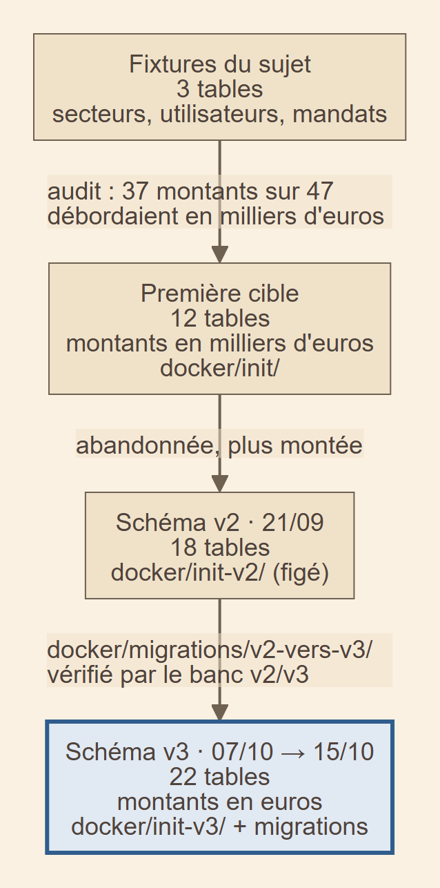
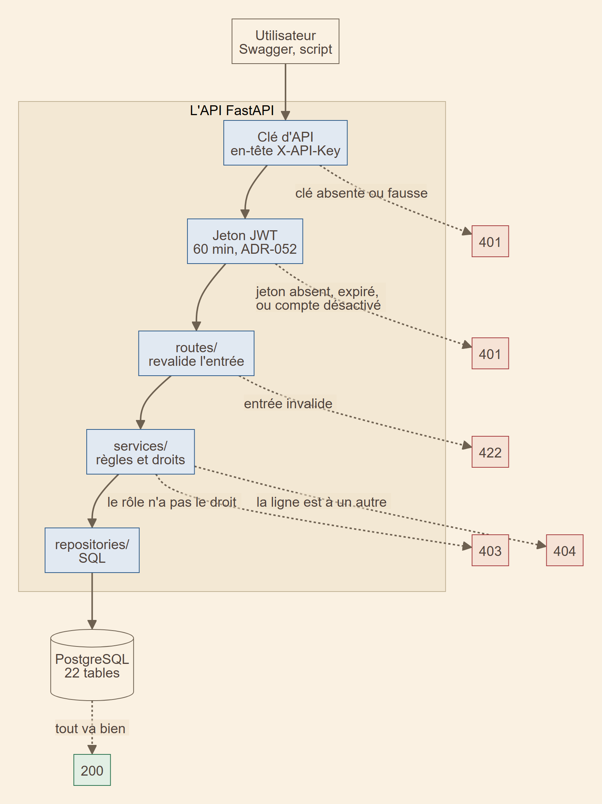
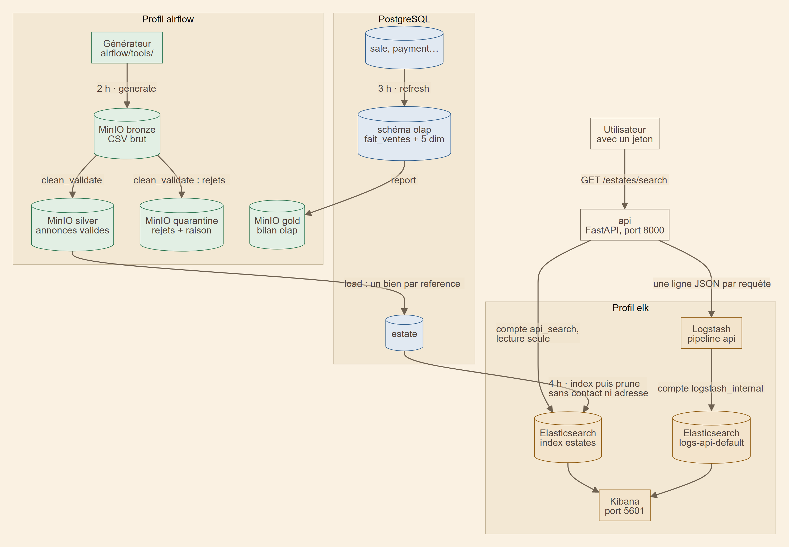
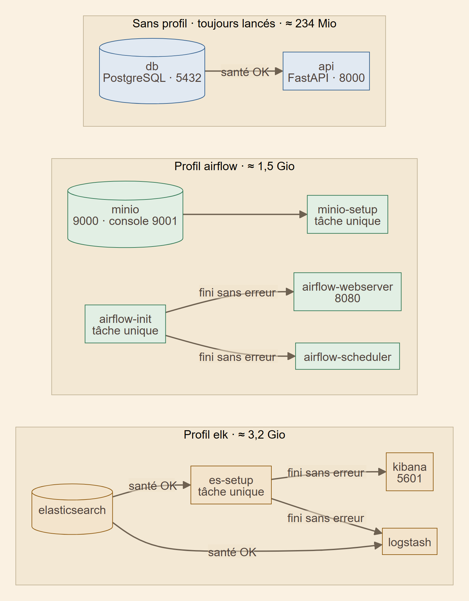

> **Version complète, gardée en annexe.** Le livrable est la version courte : `livrables/2-modelisation/2.5-cahier-des-charges-technique.md` (2026-11-20).
> ⚠️ **Numéros d'ADR décalés** dans cette annexe : plusieurs sont écrits avec un cran de trop (par exemple 015 pour les images fixes, qui sont l'ADR-014 ; 011 pour les mandats parents, qui sont l'ADR-010). Vérifié le 2026-11-20 sur le journal de décisions : la version courte du CDC et `decisions/README.md` font foi.

> **Copie de Confluence** — page « Cahier des Charges Technique » (id 25165826, version 14), espace GaSeBeLa1, copiée le 2026-11-19.
> La source qui fait foi reste Confluence : https://laurenceamethyste.atlassian.net/wiki/spaces/GaSeBeLa1/pages/25165826/Cahier+des+Charges+Technique. Les images, schémas draw.io et encadrés ne passent pas dans l'export : ils sont signalés par une ligne « 🖼️ Image ou schéma non copié : <nom ou légende si connue> ».

# Cahier des charges technique — Refonte du SI de chasse immobilière

**Version :** 2.0  
**Date de référence projet :** 25 juillet 2026  
**Statut :** proposé — à valider par le commanditaire (formateur jouant le rôle du Product Owner)  
**Mise à jour :** 2026-11-19 — montants en euros, schéma v3 (22 tables), état des écarts du § 12  

---

## Note de lecture

Chaque exigence fonctionnelle renvoie à sa source :

* `README` — Readme racine du Starter Pack (sections « Le contexte », « Le parcours utilisateur actuel », « Le futur du parcours utilisateur », « Votre mission »)
* `US-xx` — fichier `.feature` du dossier `user-stories/`, avec le tag Gherkin du scénario concerné
* `GLOSSAIRE` — `documents utiles/GLOSSAIRE-METIER.md`
* `ADR-xxx` — Journal de décisions du groupe

Deux marqueurs signalent ce qui n'est **pas** décidé :

* 🟡 **À valider** — valeur ou seuil non fourni par le commanditaire, proposé par l'équipe et à faire arbitrer
* 🔴 **Écart** — exigence qu'aucune structure du schéma cible actuel ne permet aujourd'hui de satisfaire

Le tableau complet des écarts est en **§ 12**.

**Hiérarchie des sources.** Le `README` fait foi. Le dossier `user-stories/` précise lui-même qu'il constitue « une synthèse fonctionnelle de travail, **pas un livrable officiel** », déduite du `README`. En cas de divergence entre les deux, c'est donc le `README` qui prévaut, et la divergence est signalée explicitement dans ce document plutôt que tranchée en silence.

---

## 1. Contexte et objectifs

L'entreprise exerce une activité de **chasse immobilière** : des particuliers la mandatent pour leur trouver un bien à acquérir. Le modèle économique repose sur des honoraires perçus à la signature de l'acte authentique et collectés par le notaire (`README` — Le contexte).

Le commanditaire formule trois constats, repris tels quels du `README` :

1. L'organisation actuelle de la base de données ne permet pas de gérer totalement les besoins métiers.
2. Elle ne permet pas d'absorber les volumes de données prévus par l'expansion (France, DROM, Espagne, Allemagne, Royaume-Uni, Irlande, BeNeLux, Italie, Suisse).
3. Elle ne permet pas d'y adjoindre une IA : les données ne sont ni organisées ni stockées de la bonne manière.

S'y ajoute une contrainte structurante : le backend existant expose une API dont **aucun code source n'est exploitable** et dont le développeur unique est en arrêt longue durée. Le backend est donc **à reprendre de zéro** (`README` — Le SI ; Phase 4/BC03).

**Objectif du présent document.** Traduire la note de cadrage en exigences techniques vérifiables, couvrant les quatre phases du projet, de façon qu'un développeur ou un prestataire puisse concevoir, développer et recetter sans avoir à deviner.

Pour le pourquoi, les objectifs business et le périmètre projet : voir la **Note de cadrage**.

---

## 2. Périmètre fonctionnel

### 2.1 Dans le périmètre

* Le **modèle de données cible** et son script de migration depuis l'existant (`fixtures/`)
* Le **backend et son API**, reprise de zéro, couvrant les parcours particulier et chasseur décrits au `README`
* La **séparation transactionnel / analytique** (OLTP / OLAP) et l'alimentation du modèle décisionnel
* La **conception** de la couche IA : schéma du programme d'IA, modèle de matching bien/demande et son jeu de features
* L'**ouverture contrôlée** des données à un assistant IA (périmètre d'accès, pseudonymisation, souveraineté)
* La **documentation** du projet et les quatre notes transverses obligatoires

### 2.2 Hors périmètre

* Le **site web prospect** et l'**application métier** : conservés tels quels, adaptés par leurs propres développeurs à partir de la documentation produite ici (`README` — Le SI)
* Le **rendu graphique** de l'espace acquéreur : seules des **préconisations** d'accessibilité sont produites (`README` — Exigences transverses)
* L'**entraînement** effectif du modèle de matching : la Phase 4 exige la conception de la base qui nourrit le modèle, pas son entraînement (`README` — Phase 4)
* L'**armoire à dossiers papier**, hors de tout périmètre numérique
* Les blocs **BC04** (cybersécurité) et **BC06** (DevOps), non couverts par le projet

### 2.3 Ce qui reste à clarifier avec le commanditaire

🟡 Le `README` mentionne que le mandat est signé lors d'un rendez-vous, sans préciser si la **signature électronique** est dans le périmètre du backend ou déléguée à un service tiers. Le schéma cible prévoit `mandate.signature_type IN ('electronic','paper')` mais ne dit rien du dispositif.

🟡 Le **vendeur** et le **notaire** apparaissent dans les parcours (transmission de l'offre, collecte des honoraires) mais le `GLOSSAIRE` place le vendeur « hors périmètre direct ». Leur statut dans le modèle de données doit être tranché.

---

## 3. Exigences fonctionnelles

### 3.1 Règles métier transverses — mandat et rémunération

_Source :_ `README` — Le contexte ; `US-00` (`00_regles_metier_mandat_remuneration.feature`)

| ID | Exigence | Source |
| --- | --- | --- |
| EF-01 | Le système doit permettre d'enregistrer un mandat de recherche avec sa date de signature, son mode de signature, son caractère exclusif ou non-exclusif, et sa date de fin de validité. | `US-00` @duree-mandat ; `US-01` @signature-mandat |
| EF-02 | La date de fin de validité d'un mandat doit être égale à la date de signature + 6 mois. Un mandat signé le 25/02/2026 se termine le 25/08/2026. | `US-00` @duree-mandat |
| EF-03 | Un mandat doit pouvoir être renouvelé à son échéance si aucune vente n'a abouti, en conservant le lien vers le mandat précédent. | `US-00` @duree-mandat ; `ADR-011` |
| EF-04 | Sous mandat **exclusif**, le système doit interdire qu'un autre chasseur agisse pour le compte du même client pendant la durée du mandat. | `US-00` @exclusif |
| EF-05 | Sous mandat **exclusif**, le droit à rémunération du chasseur doit être conservé même lorsque le client trouve et achète un bien par ses propres moyens. | `US-00` @exclusif |
| EF-06 | Sous mandat **non-exclusif**, le système doit permettre la coexistence de plusieurs mandats non-exclusifs pour un même client, y compris avec des chasseurs d'autres agences. | `US-00` @non-exclusif |
| EF-07 | Sous mandat **non-exclusif**, le système ne doit pas générer de droit à rémunération automatique lorsque le client trouve seul ; la rémunération revient au chasseur à l'origine de la transaction aboutie. | `US-00` @non-exclusif |
| EF-08 | 🔴 Le système doit enregistrer, à la signature de l'acte authentique, les honoraires dus à l'entreprise, composés d'un **montant fixe** et d'un **pourcentage du montant d'achat**, collectés par le notaire pour le compte de l'entreprise. | `README` — Le contexte ; `US-00` @remuneration @notaire ; `US-03` @paiement-honoraires |
| EF-09 | 🔴 Le système doit gérer un **barème de commission par tranches de montant**, variable dans le temps **et** propre à chaque chasseur, et déterminer la part reversée au chasseur en appliquant la tranche en vigueur à la date et pour le chasseur concernés. | `README` — Le contexte ; `US-00` @bareme ; `GLOSSAIRE` — Barème de commission |
| EF-10 | 🔴 Le système doit calculer les indicateurs de performance d'un chasseur à partir des cinq critères définis : délai entre signature du mandat et acte authentique arrondi à la semaine inférieure ; caractère exclusif du mandat ; nombre de ventes réussies ; nombre de mandats signés ; nombre de visites avant achat — **moins il y a de visites, plus la rémunération monte**. | `README` — Le contexte ; `US-00` @performance |

> **Deux entités nommément exigées par le commanditaire.** La Phase 2 du `README` ne se contente pas de décrire un besoin : elle nomme les structures attendues — « `baremes_commission` (par **tranches de montant**, variables dans le temps et par chasseur) + `paiements` ». EF-09 et les exigences de rémunération ne sont donc pas des déductions de l'équipe à partir des user stories, mais une **commande explicite du livrable de Phase 2**. Leur absence du schéma cible (§ 12, écarts 2 et 4) est un manquement direct à l'énoncé, pas un simple choix de périmètre.

> **Point de vigilance pour la soutenance.** Le `README` établit que le barème varie « en fonction de leur ancienneté et de leur performance », mais **l'ancienneté n'apparaît pas** dans la liste des cinq critères de performance. Ancienneté et performance sont donc deux entrées distinctes du barème. ✅ Tranché depuis : [ADR-037](../../decisions/adr-037-anciennete-performance-majorent-taux.md), accepté le 2026-10-12.

> **Ambiguïté de rédaction du** `README`. Le cinquième critère de performance est écrit « nombre de visites avant achat (**au moins il y en a, au plus la rémunération monte**) ». La formulation est fautive. `US-00` l'interprète comme « moins il y en a, plus la rémunération monte », lecture retenue ici car c'est la seule cohérente avec l'économie du métier — un chasseur efficace trouve vite. Elle conditionne le **sens du calcul** de l'indicateur. ✅ Tranché depuis : [ADR-048](../../decisions/adr-048-note-du-chasseur-cinq-criteres.md), point 4, accepté le 2026-10-12 ; comptes validés par le Product Owner le 2026-10-07.

### 3.2 Parcours particulier — demande et création de compte

_Source :_ `README` — Le particulier, étapes 1 à 3 ; `US-01`

| ID | Exigence | Source |
| --- | --- | --- |
| EF-11 | Le système doit enregistrer une demande de recherche soumise via le formulaire en ligne et déclencher un processus d'affectation de chasseur. | `US-01` @formulaire |
| EF-12 | 🔴 Une fois l'affectation confirmée, le système doit notifier le particulier en lui indiquant le chasseur affecté et l'inviter à finaliser la création de son compte acquéreur. | `US-01` @notification @affectation |
| EF-13 | Le particulier doit pouvoir finaliser la création de son compte et accéder à l'espace acquéreur pour suivre sa recherche. | `US-01` @creation-compte |
| EF-14 | Le mot de passe ne doit jamais être stocké en clair, sous aucune forme et à aucune étape — ni en base, ni en logs, ni en cache. Seule la chaîne encodée produite par Argon2id est conservée. | `ADR-017` |
| EF-15 | Lors du premier point avec le chasseur, le système doit permettre de préciser la recherche puis d'enregistrer le mandat signé. | `US-01` @premier-rendez-vous |

> 🟡 Le `README` indique qu'« un chasseur est affecté au prospect » sans préciser la **règle d'affectation** (zone, charge, performance, tour de rôle). Le CDC v1 supposait une affectation « au chasseur le plus performant sur la zone » : cette règle n'est écrite nulle part dans les sources. À faire trancher avant développement.

### 3.3 Parcours particulier — propositions, visites, avis

_Source :_ `README` — Le particulier, étapes 4 à 6 ; `US-02`

| ID | Exigence | Source |
| --- | --- | --- |
| EF-16 | Le particulier doit pouvoir consulter la liste des biens que son chasseur lui propose dans le cadre de sa recherche. | `US-02` @propositions |
| EF-17 | 🔴 Le particulier doit pouvoir désigner un ou plusieurs biens à faire visiter par son chasseur. | `US-02` @propositions |
| EF-18 | Le système doit mettre à disposition du particulier les recommandations et l'avis du chasseur sur chaque bien visité. | `US-02` @avis-chasseur |
| EF-19 | Lorsqu'aucun bien ne convient, le système doit permettre de relancer le cycle de propositions. | `US-02` @boucle-selection |
| EF-20 | Lorsqu'un bien convient, le système doit orienter le particulier vers une visite du bien **par le particulier lui-même** ou vers une offre d'achat directe. | `US-02` @bien-retenu |

### 3.4 Parcours particulier — offre, acte authentique, facturation

_Source :_ `README` — Le particulier, étapes 6 à 9 ; `US-03`

| ID | Exigence | Source |
| --- | --- | --- |
| EF-21 | 🔴 Le particulier doit pouvoir formuler une offre d'achat sur un bien retenu, transmise au vendeur par l'intermédiaire du chasseur. | `US-03` @offre-achat |
| EF-22 | Si le vendeur refuse l'offre, le système doit permettre soit la formulation d'une nouvelle offre, soit la relance du cycle de propositions (voir EF-42, même événement vu côté chasseur). | `US-03` @offre-refusee ; `US-06` @offre-refusee |
| EF-23 | Si le vendeur accepte l'offre, le système doit permettre au chasseur d'organiser la signature de l'acte authentique chez le notaire. | `US-03` @offre-acceptee |
| EF-24 | 🔴 Le système doit enregistrer la signature de l'acte authentique et le règlement des honoraires, payés par l'acquéreur séparément du prix du bien et collectés par le notaire. | `US-03` @paiement-honoraires ; `GLOSSAIRE` — Honoraires |
| EF-25 | 🔴 Une fois la transaction finalisée, le système doit produire la facture du particulier. | `US-03` @facture |
| EF-26 | 🔴 Le système doit inviter le particulier à s'exprimer sur son expérience et permettre l'envoi ultérieur d'offres de services. | `US-03` @fin-parcours |

### 3.5 Parcours chasseur — prise en charge de la demande

_Source :_ `README` — Le chasseur, étapes 1 à 4 ; `US-04`

| ID | Exigence | Source |
| --- | --- | --- |
| EF-27 | 🔴 Le chasseur doit être notifié de toute demande de recherche qui lui est affectée. | `US-04` @reception-demande |
| EF-28 | 🔴 Le chasseur doit pouvoir refuser une demande ; celle-ci devient alors réaffectable à un autre chasseur. | `US-04` @refus |
| EF-29 | À l'acceptation de la demande, le système doit présenter au chasseur le résultat d'une recherche initiale de biens correspondant à la demande. | `US-04` @acceptation |
| EF-30 | 🔴 Le système doit permettre de tracer la prise de contact avec le prospect et la fixation d'un rendez-vous, en présentiel ou en ligne. | `US-04` @prise-de-contact |
| EF-31 | Le système doit enregistrer les critères de recherche affinés lors du rendez-vous, ainsi que le mandat signé et sa date de fin de validité. | `US-04` @affinage-criteres |

> 🟡 Le CDC v1 imposait une prise de contact « sous 24h » assortie d'une pénalité de performance. Ce délai et cette pénalité ne figurent dans aucune source. Si l'équipe souhaite les conserver, ils doivent faire l'objet d'un ADR et d'une validation du commanditaire.

### 3.6 Parcours chasseur — sélection quotidienne et retour client

_Source :_ `README` — Le chasseur, étapes 5 à 6 ; `US-05`

| ID | Exigence | Source |
| --- | --- | --- |
| EF-32 | 🔴 Le système doit produire, pour chaque mandat actif, une **sélection quotidienne** de biens correspondant aux critères de recherche, pouvant être générée plusieurs fois par jour dans les zones tendues. | `README` — Le chasseur, étape 5 ; `US-05` @selection-quotidienne |
| EF-33 | Le chasseur doit pouvoir opérer sa propre sélection à partir de celle produite par le système avant de la transmettre au client. | `US-05` @transmission-client |
| EF-34 | 🔴 Le particulier doit pouvoir **commenter et prioriser** les biens de la sélection reçue. | `README` — Le chasseur, étape 6 ; `US-05` @retour-client |
| EF-35 | 🔴 Le chasseur doit être alerté dès que son client a commenté et priorisé la sélection. | `US-05` @alerte |
| EF-36 | Au vu du retour client, le chasseur doit pouvoir engager les discussions sur un bien ou en organiser la visite. | `US-05` @engagement |
| EF-37 | Lorsqu'aucun bien de la sélection ne convient, le chasseur doit pouvoir **requalifier** la recherche ; les critères ajustés servent de base à la sélection suivante, sans perte de l'historique des versions précédentes. | `US-05` @requalification ; `GLOSSAIRE` — Version de demande ; `ADR-014` |

### 3.7 Parcours chasseur — note d'avis et offre d'achat

_Source :_ `README` — Le chasseur, étapes 7 à 9 ; `US-06`

| ID | Exigence | Source |
| --- | --- | --- |
| EF-38 | Le chasseur doit pouvoir rédiger une note d'avis sur un bien après investigation, et y joindre des **commentaires audio et des vidéos**. | `US-06` @note-avis |
| EF-39 | La note d'avis doit être mise à disposition du client. | `US-06` @note-avis |
| EF-40 | 🔴 Lorsque le client souhaite se porter acquéreur, le système doit lui présenter une offre d'achat **pré-remplie** à partir des conclusions du chasseur, notamment le montant de l'offre, que le client peut compléter et signer. | `US-06` @offre-prete |
| EF-40 bis | Lorsque le client, après lecture de la note d'avis, **ne souhaite pas** se porter acquéreur du bien, le système doit établir une nouvelle sélection quotidienne. | `README` — Le chasseur, étape 8 ; `US-06` @client-non-interesse |
| EF-41 | 🔴 Le système doit gérer le statut de l'offre transmise au vendeur (en attente de réponse, acceptée, refusée). | `US-06` @transmission-vendeur, @offre-refusee, @offre-acceptee |
| EF-42 | En cas de refus du vendeur, le chasseur doit pouvoir proposer une nouvelle offre ; à défaut, une nouvelle sélection quotidienne est établie. | `US-06` @offre-refusee |
| EF-43 | En cas d'acceptation, le système doit permettre l'organisation du rendez-vous de signature chez le notaire. | `US-06` @offre-acceptee |

### 3.8 Parcours chasseur — rémunération et performance

_Source :_ `README` — Le chasseur, étapes 10 à 13 ; `US-07`

| ID | Exigence | Source |
| --- | --- | --- |
| EF-44 | 🔴 À l'enregistrement des honoraires reçus par l'entreprise, le système doit prévenir le chasseur du paiement proche de sa rémunération **et de son montant**, afin qu'il prépare sa facture. | `US-07` @notification-paiement-proche |
| EF-45 | 🔴 Le chasseur doit pouvoir déposer sa facture dans le système, laquelle passe alors en état « soumise à vérification ». | `US-07` @envoi-facture |
| EF-46 | 🔴 Une fois la facture affichée comme vérifiée et conforme, le paiement de la rémunération doit être affiché comme programmé. | `US-07` @facture-verifiee |
| EF-47 | 🔴 Une fois le paiement effectué, la somme doit être marquée payée et les indicateurs de performance du chasseur recalculés puis affichés. | `US-07` @paiement-effectue |
| EF-48 | 🔴 À l'échéance d'un mandat sans vente aboutie, le système doit inviter le chasseur à prendre rendez-vous pour un renouvellement, et recalculer ses indicateurs de performance **à la baisse**. | `README` — Le chasseur, étape 13 ; `US-07` @renouvellement-mandat |

### 3.9 Parcours futur — assistance IA du particulier

_Source :_ `README` — Le futur du parcours utilisateur, Le particulier ; `US-08`  
_Statut : conception exigée en Phase 4 ; l'entraînement des modèles est hors périmètre._

| ID | Exigence | Source |
| --- | --- | --- |
| EF-49 | Pendant le remplissage du formulaire, le système doit afficher des indicateurs de **faisabilité** du projet d'achat et inciter à affiner ou corriger la recherche au regard de la réalité du marché et des annonces disponibles. | `US-08` @faisabilite |
| EF-50 | 🟡 À l'affectation, le système doit produire une description rédigée en fonction du profil du particulier **et** du profil d'un second acteur — voir la divergence de sources ci-dessous. | `README` — Le futur, particulier, étape 2 ; `US-08` @personnalisation |
| EF-51 | Chaque choix ou rejet de bien par le particulier doit donner lieu à une proposition de modification de la recherche tenant compte des goûts déduits de cette action. | `US-08` @apprentissage-preferences |
| EF-52 | Après l'achat, le système doit sélectionner et rédiger des offres et articles adaptés au profil du particulier. | `US-08` @offres-personnalisees |

> **Divergence de sources sur EF-50.** Le `README` écrit que le particulier « reçoit une description rédigée en fonction du profil du **vendeur** et du sien ». `US-08` traduit par « profil du **chasseur** ». Les deux ne disent pas la même chose, et l'étape concernée est celle de l'affectation du chasseur — moment où aucun vendeur n'est encore identifié, puisqu'aucun bien n'a été proposé. La lecture « chasseur » est donc la seule qui fasse sens dans le déroulé, et la mention « vendeur » du `README` est très probablement une coquille. **C'est une hypothèse de l'équipe, pas une certitude** : à faire confirmer avant développement. Le `README` primant sur les `.feature`, l'exigence n'est pas tranchée unilatéralement ici.

### 3.10 Parcours futur — assistance IA du chasseur

_Source :_ `README` — Le futur du parcours utilisateur, Le chasseur ; `US-09`

| ID | Exigence | Source |
| --- | --- | --- |
| EF-53 | À l'acceptation d'une demande, le système doit produire un **rapport de faisabilité complet** et indiquer comment reformuler la demande pour maximiser la réussite de la recherche. | `US-09` @rapport-faisabilite |
| EF-54 | La prise de contact et la fixation du rendez-vous doivent être automatisables. | `US-09` @automatisation-prise-de-contact |
| EF-55 | L'affinage des critères en rendez-vous doit être assisté par le système. | `US-09` @affinage-assiste |
| EF-56 | La sélection quotidienne doit être **dédoublonnée**, comparée, pré-filtrée et ordonnée par pertinence, avec **pré-calcul des possibilités d'offre en dessous du prix affiché**. | `US-09` @selection-enrichie |
| EF-57 | La requalification doit exclure automatiquement des sélections suivantes les biens ressemblant à ceux écartés par le client. | `US-09` @requalification-automatique |
| EF-58 | La note d'avis doit faire l'objet d'une pré-rédaction assistée. | `US-09` @avis-pre-rediges |
| EF-59 | Le système doit proposer plusieurs offres d'achat possibles selon la marge de négociation évaluée. | `US-09` @offres-multiples |
| EF-60 | Le système doit vérifier la facture du chasseur de façon autonome et l'afficher comme vérifiée et conforme si aucune anomalie n'est détectée. | `US-09` @verification-autonome-facture |
| EF-61 | Lors d'un renouvellement de mandat, le système doit fournir au chasseur des conseils pour améliorer la recherche. | `US-09` @conseils-renouvellement |
| EF-62 | Les chasseurs-IA doivent pouvoir **épauler** les chasseurs humains et **opérer seuls** dans les zones non couvertes physiquement. | `README` — Le futur des besoins ; `US-09` en-tête |

> **Écart avec le CDC v1.** Le CDC v1 plaçait « Chasseur-IA autonome opérant seul en zones non couvertes » en hors périmètre. Le `README` en fait au contraire un besoin explicite de la Phase 4. La conception (schéma du programme d'IA, features de matching) est donc bien dans le périmètre ; seul l'entraînement ne l'est pas.

---

## 4. Exigences non fonctionnelles

> Les seuils chiffrés ci-dessous ne figurent pas dans les sources du projet : ils sont **proposés par l'équipe** et marqués 🟡. Ils doivent être arbitrés par le commanditaire avant de servir de critères de recette. Les seuls ordres de grandeur fournis par le `README` sont : plusieurs milliers de mandats par semaine, plusieurs centaines voire milliers de biens par recherche.

| Catégorie | ID | Exigence | Critère de vérification |
| --- | --- | --- | --- |
| Performance | ENF-01 | 🟡 Le calcul des indicateurs de performance d'un chasseur s'exécute en moins de 2 s pour un historique de 500 mandats. | Test de charge sur jeu de données représentatif, date de référence 25/07/2026 |
| Performance | ENF-02 | 🟡 La génération d'une sélection quotidienne pour un mandat s'exécute dans un délai compatible avec plusieurs déclenchements par jour en zone tendue. | Test de performance OLTP ; seuil à fixer après dimensionnement 3V |
| Volumétrie | ENF-03 | L'architecture absorbe plusieurs milliers de mandats par semaine et plusieurs milliers de biens répertoriés par recherche, sur le périmètre France + DROM + 9 pays européens (le BeNeLux en compte 3). | Note de dimensionnement 3V (Phase 3) ; `README` — Le futur de l'entreprise |
| Scalabilité | ENF-04 | La croissance internationale est absorbée sans dégradation des lectures, par indexation, partitionnement, réplication ou sharding, le choix étant justifié par une matrice de décision. | Dossier d'architecture + matrice de décision (Phase 3) |
| Disponibilité | ENF-05 | 🟡 L'API est disponible hors fenêtres de maintenance planifiées. Taux cible à définir. | Supervision + journaux |
| Continuité | ENF-06 | Un plan de continuité et un plan de reprise d'activité sont définis, ainsi qu'un plan de migration des données. | PCA/PRA + plan de migration (Phase 3) |
| Sécurité | ENF-07 | Les mots de passe sont hachés avec Argon2id via `argon2-cffi`, avec vérification en temps constant et mécanisme de re-hachage progressif. Paramètres calibrés pour \~250-500 ms par hachage. | `ADR-017` ; revue de code ; absence de mot de passe en clair en base, en logs et en cache |
| Sécurité | ENF-08 | 🟡 L'accès aux données de rémunération d'un chasseur est restreint au chasseur concerné et aux profils habilités. | Test d'accès croisé + revue des droits |
| Sécurité | ENF-09 | Les endpoints d'authentification sont protégés par limitation de débit, notamment pour contenir la charge mémoire induite par Argon2id lors des pics de connexion. ✅ Codé le 2026-11-19 : 5 échecs par email ou 20 par adresse IP en 15 min → `429`, avec `Retry-After`. | `ADR-017` — Conséquences infrastructure |
| RGPD | ENF-10 | Chaque traitement fait l'objet d'une entrée au registre précisant finalité, base légale, durée de conservation et repérage des données sensibles. La protection des données est intégrée dès la conception. | `README` — Exigences transverses ; `REGISTRE-RGPD` |
| RGPD | ENF-11 | Les données personnelles exposées à un traitement analytique ou à une IA sont anonymisées ou pseudonymisées avant exposition. | Note souveraineté & sécurité IA |
| Souveraineté | ENF-12 | L'ouverture de la base à une IA se fait sur un périmètre d'accès restreint, idéalement en lecture seule, avec localisation des traitements documentée. | `README` — Souveraineté & sécurité des données |
| Accessibilité PSH | ENF-13 | Des préconisations d'accessibilité sont produites pour l'espace acquéreur, portant au minimum sur le contraste, la navigation clavier, la taille des cibles et les alternatives textuelles. | Note d'accessibilité PSH ; `README` — Accessibilité (PSH) |
| Éco-conception | ENF-14 | La politique de sauvegarde multi-fréquences (minute, heure, 12 h, 24 h) fait l'objet d'un arbitrage documenté entre coût de stockage, rétention et empreinte environnementale. | Note d'éco-conception ; `README` — Éco-conception |
| Qualité | ENF-15 | Le code produit est commenté, documenté et accompagné de tests unitaires et fonctionnels. | `README` — Livrables ; plan de tests |
| Traçabilité | ENF-16 | Chaque décision technique structurante fait l'objet d'une entrée au journal de décisions, précisant les options écartées et le motif. | `README` — Recommandations ; Journal de décisions |

---

## 5. Contraintes techniques

| Domaine | Contrainte | Source |
| --- | --- | --- |
| SGBD | **PostgreSQL**. Tout le SQL du projet est écrit en dialecte PostgreSQL. SQLite est écarté (modèle embarqué mono-écrivain) ; MySQL/MariaDB est écarté après comparaison pondérée. | `ADR-001` |
| Données de départ | Les fichiers de `fixtures/` représentent l'existant et **ne doivent pas être modifiés** : la migration part d'eux. `fixtures/PgSQL.sql` est la source de vérité ; `fixtures/MySQL.sql` sert de référence de lecture. | `README` — Règles du jeu ; `ADR-001` |
| Langue | **Anglais** pour les noms du code et les schémas de données. **Français** pour les commentaires de code et les docstrings (ADR-066, qui remplace ADR-002 sur ce point), comme pour les échanges métier et la documentation de contexte. Un glossaire de correspondance FR/EN est maintenu : `livrables/2-modelisation/annexes/glossaire-fr-en.md`, généré depuis le schéma (2026-11-23). | `ADR-002`, `ADR-066` |
| Méthodologie de modélisation | **Merise** — MCD, MLD, MPD, avec cardinalités complètes. | `README` — Livrables |
| Stockage objet | **MinIO**, S3-compatible, auto-hébergé, avec 4 buckets `bronze` / `silver` / `gold` / `quarantine` créés automatiquement au démarrage. | `ADR-016` |
| Conteneurisation | Toutes les images Docker sont **pinnées** sur une version fixe. Le tag `latest` est interdit. | `ADR-015` |
| Hachage | **Argon2id** via `argon2-cffi`. La colonne `password` doit être dimensionnée en `VARCHAR(255)`. | `ADR-017` |
| Unités monétaires | Tous les montants sont en **euros**, jamais en milliers d'euros (schéma v3, `docker/init-v3/README.md` § 1). Prix, budgets, bornes du barème et part fixe en `INTEGER` ; honoraires et paiements en `NUMERIC(12,2)`, car le calcul arrondit au centime. La convention « K€ » du jeu de données source (`NUMERIC(6,1)`) est abandonnée ; la conversion se fait une fois, à la migration. | Décision du groupe (Q-REM-01, 2026-10-05) ; EF-08, EF-09 |
| Date de référence | Tout raisonnement sur « aujourd'hui » — mandats expirés, validité des 6 mois — se fait au **25 juillet 2026**. | `README` — La base de données |
| Backend | Reprise de zéro : aucun code source exploitable de l'existant. | `README` — Le SI |
| Intégrations | 🟡 Notification (email / SMS), stockage des médias audio et vidéo des notes d'avis, dispositif de signature du mandat. Périmètre et fournisseurs à arbitrer. | `US-06` @note-avis ; `US-01` @notification |

---

## 6. Architecture cible

L'architecture repose sur une **séparation du transactionnel et de l'analytique**, exigée en Phase 3 (`README` — Phase 3).

* **Couche OLTP** — cycle de vie opérationnel : utilisateurs et rôles, demandes de recherche, critères versionnés, mandats, biens, propositions, avis, offres, transactions, facturation.
* **Couche OLAP** — pilotage : indicateurs de performance des chasseurs, analyse des recherches et des taux d'aboutissement. Alimentée depuis l'OLTP par extraction, transformation et chargement ; aucun outil ETL n'est imposé, un script SQL ou du code suffit.
* **Couche data lake** — architecture medallion `bronze` / `silver` / `gold` sur MinIO, destinée aux annonces brutes hétérogènes et aux médias.
* **Couche IA** — schéma du programme d'IA et modèle de matching bien/demande, avec son jeu de features. Conception seule ; l'exposition des données à l'IA suit ENF-11 et ENF-12.

Références : `MCD-MERISE.md`, `OLTP.md`, `OLAP.md`, Journal de décisions (`ADR-001`, `ADR-016`).

🟡 Le style d'architecture applicative — monolithe modulaire ou services séparés — n'a pas encore fait l'objet d'un ADR. À trancher en Phase 4.

### 6.1 Les schémas de l'architecture

Repris de la présentation du 16/10/2026. Source Mermaid et explications : dépôt `GaSeBeLa/Fil-Rouge`, dossier `livrables/3-architecture/`, fichiers 01 à 04.

**Schéma 1 — d'où on part, où on arrive** : 3 tables reçues, une première cible de 12 tables en milliers d'euros, puis 18, puis 22 tables en euros.

**Schéma 2 — le trajet d'une requête dans l'API** : chaque couche, et le refus qu'elle renvoie (401, 422, 403, 404).

**Schéma 3 — le chemin des données** : Airflow, MinIO, PostgreSQL, Elasticsearch, Logstash, Kibana.

**Schéma 4 — la pile Docker** : les conteneurs, leurs profils, leur ordre de démarrage et leur mémoire.

---

## 7. Données et confidentialité

### 7.1 Nature des données traitées

Le `README` qualifie la base de « saturée de données personnelles ». Le modèle cible confirme :

* **Identité et contact** : nom, prénom, email, téléphone, genre, pays
* **Situation personnelle du client** : adresse, situation matrimoniale, PACS, nombre d'enfants, date de naissance
* **Données professionnelles du chasseur** : société, niveau de formation, carte T et date de certification, taux de commission
* **Données de projet** : budgets, critères de recherche et leur historique de versions
* **Données de transaction** : montants d'offre, montants d'achat, honoraires, rémunérations
* **Médias** : photos de biens, commentaires audio et vidéo des notes d'avis

### 7.2 Points d'attention

* Les données de **situation familiale** (`is_married`, `is_civil_solidarity_pact`, `nb_children`, `birth_date`) et le **genre** appellent une justification de finalité au registre RGPD : leur nécessité pour la chasse immobilière doit être démontrée, faute de quoi le principe de minimisation impose de les retirer.
* Les **médias audio et vidéo** des notes d'avis peuvent contenir des données personnelles de tiers (voisins, vendeurs, occupants). Leur durée de conservation et leur base légale doivent être traitées explicitement.
* 🟡 Le CDC v1 mentionnait un **IBAN** et un **SIRET** de chasseur comme données sensibles à chiffrer. Ces champs n'existent ni dans le `README`, ni dans les user stories, ni dans le schéma cible. Si le versement de la rémunération est effectivement dans le périmètre, la question doit être posée au commanditaire et tranchée par un ADR — pas supposée.

Détail complet : `REGISTRE-RGPD`.

---

## 8. Livrables attendus

Repris de la Note de cadrage, sans duplication du détail.

| Phase | Livrables couverts par ce CDC |
| --- | --- |
| Phase 2 | MCD/MLD cible, `migration.sql`, note d'indexation, note stratégique, étude d'opportunité |
| Phase 3 | Dossier d'architecture, matrice de décision, schéma OLAP + description de l'alimentation, note de dimensionnement 3V, PCA/PRA, plan de migration |
| Phase 4 | Dossier de conception applicative + maquettes, plan de tests, schéma du programme d'IA, conception du modèle de matching + jeu de features |
| Transverse | Registre RGPD, note d'éco-conception, note d'accessibilité PSH, note souveraineté & sécurité IA, journal de décisions, RACI, planning |

---

## 9. Planning et jalons

Voir la **Note de cadrage**, § 6. Ce cahier des charges n'a pas de planning technique distinct.

---

## 10. Critères de recette et d'acceptation

1. **Traçabilité descendante.** Chaque exigence fonctionnelle EF-xx est reliée à au moins un cas de test du plan de tests. Une exigence sans test n'est pas recevable.
2. **Traçabilité ascendante.** Chaque scénario Gherkin des `user-stories/` est couvert par au moins une exigence de ce document. Les scénarios `@futur-ia` sont couverts au niveau **conception**, pas implémentation.
3. **Sécurité.** Aucun mot de passe en clair n'est présent en base, en logs ou en cache. La colonne `password` est dimensionnée pour Argon2id.
4. **Règles temporelles.** Les cas de test relatifs aux mandats sont évalués à la date de référence du 25 juillet 2026.
5. **RGPD.** Chaque traitement du registre porte une finalité, une base légale et une durée de conservation. Un test d'export et un test de suppression sont exécutés.
6. **Décisions.** Toute exigence marquée 🟡 dans ce document a été soit validée par le commanditaire, soit tranchée par un ADR, avant la recette.
7. **Écarts.** Tout écart marqué 🔴 est soit résolu dans le modèle cible, soit documenté et assumé avec sa justification.

Référence : `PLAN-DE-TESTS.md`.

### 10.1 Couverture des scénarios Gherkin

Vérification effectuée scénario par scénario sur les 10 fichiers `.feature` : **49 scénarios, 49 couverts**. ⚠️ Compte du 2026-09-06 ; au 2026-11-20, la matrice des tests fonctionnels compte 80 scénarios, dont 57 couverts sur les 59 du périmètre (`livrables/4-application/4.3-tests-fonctionnels.md`).

| Fichier | Scénarios | Exigences couvrantes |
| --- | --- | --- |
| `00_regles_metier_mandat_remuneration` | 7 | EF-02 à EF-10 |
| `01_particulier_demande_et_compte` | 4 | EF-11, EF-12, EF-13, EF-15 |
| `02_particulier_recherche_et_visites` | 4 | EF-16/17, EF-18, EF-19, EF-20 |
| `03_particulier_offre_et_signature` | 5 | EF-21, EF-22, EF-23, EF-24, EF-25/26 |
| `04_chasseur_prise_en_charge_demande` | 5 | EF-27, EF-28, EF-29, EF-30, EF-31 |
| `05_chasseur_selection_quotidienne_biens` | 5 | EF-32, EF-33, EF-34/35, EF-36, EF-37 |
| `06_chasseur_avis_et_offre_achat` | 6 | EF-38/39, EF-40, EF-40 bis, EF-41, EF-42, EF-43 |
| `07_chasseur_remuneration_et_performance` | 5 | EF-44, EF-45, EF-46, EF-47, EF-48 |
| `08_futur_particulier_assistance_ia` | 4 | EF-49, EF-50, EF-51, EF-52 |
| `09_futur_chasseur_assistance_ia` | 9 | EF-53 à EF-61 |

Trois exigences n'ont pas de scénario Gherkin correspondant et proviennent directement d'autres sources : **EF-01** (structure du mandat, `README`), **EF-14** (`ADR-017`), **EF-62** (chasseurs-IA autonomes, `README` — Le futur des besoins). Elles restent recevables : les `.feature` sont une synthèse partielle du `README`, pas son équivalent.

**Aucune contradiction n'a été relevée** entre les scénarios Gherkin et les exigences de ce document. Deux points de vocabulaire ont en revanche été clarifiés :

* Le parcours comporte **deux visites de nature différente** : celle effectuée par le chasseur pour rédiger sa note d'avis (EF-17, EF-38) et celle du particulier sur un bien retenu (EF-20). Le modèle de données doit les distinguer.
* Un refus du vendeur ouvre **deux issues** et non une seule : nouvelle offre, ou retour à la sélection. `US-03` ne mentionne que la seconde, `US-06` les deux ; EF-22 et EF-42 retiennent la lecture complète.

---

## 11. Annexes

* `GLOSSAIRE-METIER.md` — vocabulaire de la chasse immobilière
* Glossaire de correspondance FR/EN — `ADR-002`, `livrables/2-modelisation/annexes/glossaire-fr-en.md`
* `user-stories/` — les 10 fichiers `.feature` servant de base à la traçabilité
* Journal de décisions — ADR-001 à ADR-064, sur Confluence (ADR-004 remplacé par ADR-018)
* `01_create_fil_rouge_immobilier.sql` — schéma cible en vigueur : dépôt `GaSeBeLa/Fil-Rouge-API`, branche `main`, chemin `docker/init-v3/01_create_fil_rouge_immobilier.sql` (**22 tables**, montants en euros). L'ancien schéma audité le 06/09 (`docker/init/`, 12 tables) n'est plus monté.

---

## 12. Écarts identifiés entre les exigences et le schéma cible actuel

> **État au 2026-11-19** (colonne ajoutée, vérifiée dans la base v3) : sur 28 écarts relevés le 06/09, **20 réglés** ✅, **6 en partie** 🟡, **1 hors périmètre** ➖, **1 pas fait** ❌. Le texte de l'audit est gardé tel quel.

Cette section n'est pas une rubrique du modèle imposé. Elle est ajoutée parce que **21 exigences fonctionnelles de ce document ne peuvent aujourd'hui être satisfaites par aucune structure du schéma cible**. Ces écarts doivent être résolus ou assumés explicitement avant la soutenance.

### 12.1 Entités absentes du schéma

| # | Manque | Exigences bloquées | Gravité | État au 19/11 |
| --- | --- | --- | --- | --- |
| 1 | Aucune entité **honoraires / transaction / acte authentique**. Le montant fixe et le pourcentage n'ont nulle part où être stockés. | EF-08, EF-24 | 🔴 Critique — c'est le fait générateur de tout le modèle économique | ✅ `sale.fees_amount`, `parameters_fees` |
| 2 | Aucune entité **barème de commission par tranches**, variable dans le temps et par chasseur. `hunter.commission_rate` est un taux unique et fixe, ce qui contredit directement le `README`. La Phase 2 exige nommément une entité `baremes_commission`. | EF-09 | 🔴 Critique — **livrable de Phase 2 explicitement commandé, non produit** | ✅ `commission_scale`, `hunter_rate_parameters` |
| 3 | Aucune entité **facture** (ni particulier, ni chasseur), ni cycle de vie associé. | EF-25, EF-45, EF-46, EF-60 | 🔴 Critique | ➖ hors périmètre (Product Owner, 07/10) |
| 4 | Aucune entité **paiement / rémunération** ni ses états (proche, programmé, payé). La Phase 2 exige nommément une entité `paiements`. | EF-44, EF-46, EF-47 | 🔴 Critique — **livrable de Phase 2 explicitement commandé, non produit** | ✅ `payment` et son `status` |
| 5 | Aucune entité **indicateurs de performance** ni historisation des recalculs. | EF-10, EF-47, EF-48 | 🔴 Critique | ✅ `hunter_performance` |
| 6 | Aucune entité **visite** distincte. Le parcours en fait un objet à part entière — le client choisit les biens à visiter, le chasseur visite, le nombre de visites entre dans le calcul de performance. | EF-17, EF-36, EF-10 | 🔴 Critique | ✅ `visit` |
| 7 | Aucune entité **offre d'achat**. `estate_proposed.amount_proposition` et `is_accepted` confondent la proposition d'un bien par le chasseur et l'offre d'achat formulée par le client au vendeur — deux objets métier distincts, avec deux cycles de vie distincts. | EF-21, EF-40, EF-41, EF-42 | 🔴 Critique | 🟡 dans `estate_proposed` (`amount_proposition`, `proposition_status`), pas d'entité à part |
| 8 | Aucune entité **sélection quotidienne**. Impossible de savoir quel lot de biens a été envoyé, quand, ni de garantir le non-renvoi d'un bien déjà proposé. | EF-32 | 🔴 Majeur | 🟡 suggestions dans `estate_searchrequest`, un bien écarté n'est plus proposé ; le DAG quotidien n'est pas codé |
| 9 | Aucune structure de **priorisation** du client sur la sélection. `estate_proposed.comment_client` capte le commentaire, pas la priorité. | EF-34 | 🟡 Majeur | ✅ `estate_proposed.client_priority` |
| 10 | Aucun suivi du **cycle d'affectation** d'une demande : acceptation, refus, réaffectation. | EF-27, EF-28 | 🟡 Majeur | ✅ `search_request.status`, `id_hunter`, `id_realestatemanager` (demandes « à prendre ») |
| 11 | Aucune entité **notification / alerte**. | EF-12, EF-27, EF-35, EF-44 | 🟡 Moyen | ❌ pas d'entité notification |
| 12 | Aucune entité **rendez-vous**. | EF-30, EF-43, EF-48 | 🟡 Moyen | 🟡 seulement `visit.visit_date` |
| 13 | Aucune entité **vendeur** ni **notaire**, alors que les deux interviennent dans le parcours. | EF-21, EF-24 | 🟡 À trancher (§ 2.3) | 🟡 vendeur : `estate_contact` (ADR-054) ; notaire : hors périmètre |
| 13 bis | Aucune entité **commentaire** au sens du `README` Phase 2 : « commentaire sur un bien dans le contexte d'une demande, **par un client ou un chasseur** ». Le schéma s'en approche avec `estate_proposed.comment_hunter` / `comment_client`, mais sous forme de deux colonnes figées : un seul commentaire par acteur et par proposition, pas d'auteur, pas d'horodatage propre, pas de fil de discussion. | EF-16, EF-34, EF-39 | 🟡 Majeur — **entité nommée dans le livrable de Phase 2** | ✅ `estate_proposed.comment_hunter` / `comment_client`, `estate_searchrequest.review_hunter` |
| 13 ter | **Aucune localisation sur la demande.** Ni `search_request` ni `criteria` ne portent de ville, code postal ou secteur, alors qu'`estate` dispose de `town`, `postal_code`, `latitude` et `longitude`. Le rapprochement géographique entre un bien et une demande est donc impossible, alors qu'il s'agit du critère le plus discriminant d'une recherche immobilière. Dans les données migrées, la localisation souhaitée est restée en texte libre dans `criteria.change_reason` (« T3 Ecusson », « T4 Croix-Rousse ») : l'anomalie C10 n'est résolue qu'en partie. Origine : abandon des tables `Area` et `Town` prévues par `ADR-010`, sans structure de remplacement. | EF-29, EF-32, EF-56 | 🔴 **Bloquant.** Aucun matching possible. À trancher avant toute conception de la sélection quotidienne. | ✅ `criteria.country_iso`, `town`, `postal_code`, `district` |
| 13 quater | `criteria.typology` est `NOT NULL`, mais `estate` ne porte aucune colonne `typology`. Le seul critère obligatoire de la demande (T2, T3, T4…) n'a pas d'équivalent côté bien : les 2 556 biens chargés ne savent pas de quelle typologie ils relèvent. Le matching sur le critère le plus structurant après la localisation est donc impossible. | EF-29, EF-32, EF-56 | 🔴 **Bloquant.** Ajouter `typology` à `estate`, dérivable de `nb_rooms` à la migration. | 🟡 `estate.typology` existe, mais 0 bien sur 3 219 l'a rempli |
| 13 quinquies | **Unité DPE non alignée.** La demande exprime son critère énergétique par `criteria.energy_kwh_m2_min/max`, le bien par `estate.energetic_score` (`CHECK > 0`). Rien ne garantit qu'il s'agisse de la même unité, et aucune des deux colonnes n'est documentée. S'ajoute au fait qu'`energetic_score` est `NULL` sur toutes les lignes (#21). | EF-32 | 🟡 Majeur — aligner les noms et documenter l'unité par `COMMENT ON COLUMN`. | ✅ aligné sur la classe : `criteria.energy_class_max` ↔ `estate.energy_class` |
| 13 sexies | **Deux tables de liaison bien ↔ demande coexistent sans arbitrage.** `estate_proposed` est rattachée au mandat et porte les commentaires, le montant proposé et l'acceptation ; `estate_searchrequest` est rattachée à la demande et porte l'avis du chasseur et les médias. Le même couple bien/demande peut exister dans les deux, aucune contrainte ne l'empêche, et rien ne dit laquelle fait foi. | EF-16, EF-32, EF-38, EF-40 | 🟡 Majeur — décision de modélisation à trancher, puis ADR. Conditionne le rattachement de la future table `comment`. | ✅ rôles séparés : `estate_proposed` côté mandat, `estate_searchrequest` côté demande |

### 12.2 Défauts internes du schéma

| # | Défaut | Conséquence | État au 19/11 |
| --- | --- | --- | --- |
| 14 | Les six colonnes monétaires typées `NUMERIC(6,1)` expriment des montants en **milliers d'euros**, convention héritée du jeu de données source (2 556 biens, valeurs de 62,5 à 406,0). Le plafond réel est donc de 99 999,9 K€ ≈ 100 M€ — suffisant. Mais **cette convention n'était documentée nulle part** : ni commentaire, ni `COMMENT ON`, ni mention au dictionnaire de données. Une API insérant des euros passerait les `CHECK` sans erreur et corromprait la donnée d'un facteur 1000. Par ailleurs, la précision de `NUMERIC(6,1)` en K€ est de **100 €** : acceptable pour un prix d'annonce, à proscrire pour les montants d'acte authentique et les honoraires calculés en pourcentage (EF-08, EF-09), qui doivent être stockés en euros en `NUMERIC(12,2)`. | ✅ **Traité.** Convention documentée en en-tête de script, en commentaire inline sur chaque colonne et via six `COMMENT ON COLUMN`. Le typage est inchangé — décision du groupe de conserver les K€. Reste à appliquer : les futures entités financières (honoraires, paiements, factures) doivent utiliser l'euro, pas le K€. | ✅ euros, `INTEGER` et `NUMERIC(12,2)` |
| 15 | ~~Contradiction entre~~ `ADR-004` et le schéma sur `mandate.ends_at` — **résolu par** `ADR-018` (06/09/2026), qui entérine `ends_at` stocké, écarte `duration` et `renewal_count`, et fait passer l'`ADR-004` au statut « remplacé ». Le nombre de renouvellements se déduit de la chaîne `id_mandate_parent` (`ADR-011`). | Aucun. Écart clos. Reste à appliquer : trigger ou service pour calculer `ends_at` à la création, et `COMMENT ON COLUMN` rappelant que la valeur est figée à la signature. | ✅ résolu (ADR-018) |
| 16 | `ADR-008` décide de scinder le téléphone en `country_code` + `phone_number`. Le schéma ne comporte qu'un `phone_number VARCHAR(20)`. | ADR accepté non appliqué. | 🟡 `country_iso` + `phone_number` : à confronter à l'ADR-008 |
| 17 | `password VARCHAR(80)` — **résolu**. La version en vigueur dans `docker/init/01_create_fil_rouge_immobilier.sql` déclare bien `password VARCHAR(255) NOT NULL`, conforme à `ADR-017`. | Aucun. Écart clos. | ✅ résolu |
| 18 | `ADR-006`, `ADR-009`, `ADR-010`, `ADR-013` décrivent des entités inexistantes — **traité par** `ADR-019` (06/09/2026), qui clôt les cinq ADR périmés, acte le modèle réel et distingue ce qui a été abandonné à raison de ce qui reste à faire. `ADR-007`, resté vide au statut « accepté », est annulé. | Reste à appliquer : `country_code` de l'`ADR-008` (reporté, non abandonné), arbitrage sur `free_comment`, et surtout la localisation de la demande (#13 ter). Vérifier également que les schémas MCD/MLD/MPD ne décrivent plus `Area`, `Town`, `Dpe` ni `SearchRequest_Criteria`. | ✅ traité (ADR-019) |
| 19 | `ADR-005` signale l'absence de contrainte d'exclusivité entre `hunter`, `client` et `real_estate_manager` : rien n'empêche un même `id_user` d'exister dans plusieurs sous-tables. L'anomalie C12 de l'existant reste donc structurellement possible. | Écart connu et documenté. À assumer explicitement à l'oral, ou à traiter par trigger. | ✅ 3 triggers `trg_*_one_profile` |
| 20 | `estate_searchrequest` mélange trois responsabilités : jonction bien ↔ demande, avis du chasseur, et média. `media_type` est `NOT NULL`, ce qui interdit d'enregistrer un avis textuel sans média. | 🔴 EF-38 et EF-39 sont partiellement bloquées. | ✅ médias dans `review_media` : un avis texte seul est possible |
| 21 | `estate.energetic_score` est renseigné `NULL` pour toutes les lignes chargées, alors que les valeurs de DPE existent dans les données source. La conversion n'a jamais été appliquée dans le script de normalisation. | Un critère de recherche annoncé comme structurant (`GLOSSAIRE` — DPE) est vide en base. | ✅ `estate.energy_class` rempli pour 1 679 biens sur 3 219 |
| 22 | **Asymétries entre** `criteria` et `estate` relevées à l'audit du 06/09 : `estate.nb_bathrooms` n'a pas d'équivalent recherchable dans `criteria` ; `criteria.surface_min/max` est `NUMERIC(6,2)` contre `NUMERIC(7,2)` pour `estate.surface`, et `NUMERIC(8,2)` contre `NUMERIC(9,2)` pour le terrain — un bien de 15 000 m² est donc stockable mais pas cherchable ; `criteria.is_new_build` (BOOLEAN) face à `estate.construction_date` (DATE) suppose une règle de conversion non écrite ; `criteria` exprime enfin la piscine deux fois, par `has_swimming_pool` et par `swimming_pool_min/max`. | Le matching bien/demande ne peut être conçu tant que les paires de colonnes ne sont pas alignées deux à deux. À traiter avec la conception de la sélection quotidienne (EF-32). | ✅ en partie : `criteria.bathrooms_min/max` ajoutés |
| 23 | `role` est la seule des douze tables à ne pas porter de `created_at`. | Cosmétique, mais visible à la relecture du schéma. | ✅ `role.created_at` existe |

### 12.3 Ordre de traitement recommandé

> ⚠️ **Ordre dépassé** : il date de l'audit du 06/09. Ce qui reste est dans la colonne « État au 19/11 ».

1. **Rendre le matching possible** — c'est désormais la priorité absolue, et elle passe devant tout le reste : la demande ne porte aucune localisation (#13 ter) et le bien aucune typologie (#13 quater). Sans ces deux corrections, la sélection quotidienne — cœur du métier et de la Phase 4 — ne peut ni être conçue ni être démontrée. À traiter avec les asymétries de colonnes (#22) et l'unité DPE (#13 quinquies).
2. **Trancher entre** `estate_proposed` et `estate_searchrequest` (#13 sexies) — deux tables de liaison concurrentes, sans arbitrage écrit. Conditionne le rattachement de la future table `comment`.
3. **Réconcilier les ADR et le schéma** (#15, #16, #18) — soit corriger le schéma, soit réviser les ADR par un nouvel ADR de révision. C'est le risque le plus élevé pour la soutenance individuelle.
4. **Réconcilier les ADR périmés** (#15, #16, #18) — traité par les ADR-018 et ADR-019, reste à publier dans Confluence et à vérifier sur les schémas MCD/MLD/MPD.
5. **Les trois besoins nommés en Phase 2** — `baremes_commission` (#2), `paiements` (#4) et `commentaires` (#13 bis). Le `README` les liste dans le livrable de Phase 2 ; leur absence est le reproche le plus facile à formuler par le jury.
6. **Le reste du bloc financier** (#1, #3, #5) — honoraires/acte authentique, facture, indicateurs de performance. Sans eux, tout le pan « rémunération » du `README` reste hors modèle.
7. **Entités du bloc parcours** (#6 à #10) — visite, offre d'achat, sélection quotidienne, priorisation, affectation.
8. **Entités de support** (#11 à #13) — notification, rendez-vous, vendeur/notaire, à arbitrer selon le périmètre retenu.
9. **Corrections mineures** — `media_type NOT NULL` (#20), `energetic_score` vide (#21), `role.created_at` (#23).
