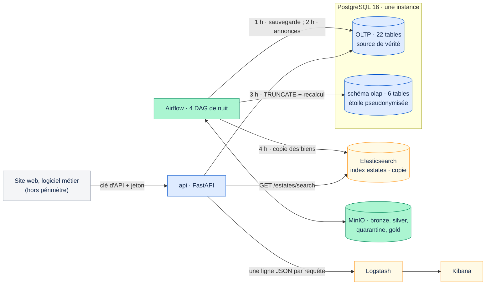

> **Version complète, gardée en annexe.** Le livrable est la version courte : `livrables/3-architecture/dossier-architecture.md` (2026-11-20).

# Dossier d'architecture — absorber la croissance

> Phase 3, BC01. Format cible : « 1 schéma de composants + 1 matrice de
> décision + 2-3 pages » (`SP/documents utiles/GRILLE-EVALUATION.md:20`).
> Compétences : comparer les architectures (OLTP/OLAP, réplication,
> partitionnement, sharding), analyser les composants et leurs points de
> performance (`SP/documents utiles/TRACABILITE-COMPETENCES.md:35-37`).
>
> Version du 2026-11-20. Ce document **relie** ce qui
> existe : les 4 schémas de ce dossier, la note 3V, l'OLAP et les ADR. Il ne les
> recopie pas.
>
> Statuts : ✅ établi (lu dans le code ou mesuré) · 🟡 à décider · 💡 proposé ·
> ⚠️ limite connue.

## 1. Le besoin

Le sujet demande de dimensionner pour la croissance (France, DROM et 9 pays),
de comparer les architectures, et de **séparer le transactionnel de
l'analytique** (`SP/Readme.md:245-247`). La note 3V chiffre la cible : de
**22 à 133 Go** de base après 2 ans, **285 à 712** nouveaux mandats par jour,
et un scraping de **9 à 56 pages par seconde** (note 3V § 3 et § 4).

## 2. Les composants

Le schéma de composants est déjà fait : [04 — la pile Docker](../../livrables/3-architecture/04-pile-docker.md)
(11 conteneurs, 3 profils) et [03 — le chemin des données](../../livrables/3-architecture/03-chemin-des-donnees.md)
(flux de nuit, recherche, logs). En voici la lecture par couche, avec le point
de performance de chacune.

| Composant | Rôle | Point de performance | Source |
|---|---|---|---|
| `api` (FastAPI) | règles métier, droits, calcul du paiement | ⚠️ connexion : argon2 à **512 Mo et ~298 ms par essai** ; dix connexions simultanées ≈ 5 Go. Freinées depuis le 2026-11-19 : 5 échecs par email ou 20 par IP en 15 min → `429` | `utils/security.py:45`, commit `e6f4b87` |
| | | ⚠️ le compte est relu en base à **chaque** appel : une requête de plus, voulue pour la sécurité | ADR-052, décision 3 |
| | | ⚠️ pas de pagination : `GET /estates` rend tous les biens d'un coup (3 219 sur la base de développement : 1,25 s, mesuré le 2026-11-20) | `API/README.md`, « Limites connues » |
| PostgreSQL, OLTP | 22 tables, contraintes, triggers | ✅ **7 index** posés à la main, dont 3 le 2026-11-19 après mesure (× 15 à × 100, `../2-modelisation/note-indexation.md`) ; ⚠️ PostgreSQL n'indexe pas seul les clés étrangères : les autres n'ont pas d'index dédié, sauf quand une contrainte `UNIQUE` les couvre. **0** table partitionnée | `init-v3/01_create_fil_rouge_immobilier.sql` |
| PostgreSQL, `olap` | l'étoile du sujet, une ligne par vente | ✅ précalculée : l'analyse ne refait pas les jointures du métier. ⚠️ recalcul **complet** chaque nuit, 0 index | `airflow/src/olap/load.py`, `08_olap.sql` |
| Elasticsearch | recherche texte, ville, prix, distance | ✅ arrêté, seule la recherche répond `503`. ⚠️ 1 shard, 0 réplique ; jusqu'à 24 h de retard | ADR-061, `airflow/src/search/mapping.py` |
| Airflow | sauvegarde, import, OLAP, index : quatre DAG de nuit | ⚠️ `LocalExecutor`, une seule machine : ne tiendra pas 9 à 56 pages par seconde | ADR-059, note 3V § 6 |
| MinIO | traces de chaque étape du flux | ✅ un rejet garde sa raison (`quarantine`) ; ⚠️ aucune réplication | ADR-060 |
| Logstash, Kibana | logs de l'API, tableau de bord | ✅ hors du chemin des requêtes : un ELK arrêté ne bloque pas l'API | `docker/logstash/` |

Mémoire au repos, mesurée le 2026-10-15 : **234 Mio** pour `db` et `api`
seuls, **5,0 Gio** avec tous les profils (ADR-062).

## 3. Comparer les architectures

### 3.1 OLTP et OLAP : pourquoi les séparer

| | OLTP (le métier) | OLAP (l'analyse) |
|---|---|---|
| Question type | « ce mandat est-il signé ? » | « commission moyenne par secteur et par trimestre ? » |
| Forme | 22 tables normalisées, contraintes fortes | une étoile : `fait_ventes` + 5 dimensions |
| Écritures | à chaque action d'un utilisateur | une fois par nuit, tout d'un coup |
| Données personnelles | oui, nominatives | non : des numéros et des attributs non identifiants (RGPD-13) |
| Fraîcheur | immédiate | au plus une nuit de retard |

Séparer les deux protège le métier des requêtes lourdes, et donne à l'analyse,
et demain à l'IA, une vue **sans nom ni contact**.

### 3.2 Quatre architectures comparées

La [matrice de décision](../../livrables/3-architecture/matrice-decision-architecture.md) compare quatre
options sur six critères pondérés : une base unique (**77**/120), **OLTP + OLAP
dans la même instance (92)**, un entrepôt séparé (81), des microservices (65).
B reste en tête si l'on change les poids, sauf à ne regarder que la
performance et la scalabilité.

✅ **Retenue : B.** Elle sépare ce que le sujet demande de séparer, sans second
moteur ni exploitation que l'équipe ne pourrait pas tenir.

### 3.3 Les arbitrages

Sept compromis tranchés, chacun avec ce qu'il coûte : matrice, § 6. Les trois
qui pèsent le plus :
- **sécurité avant performance** : argon2 à 512 Mo par connexion, et le compte
  relu à chaque appel ;
- **simplicité avant scalabilité** : une seule instance pour le métier et
  l'analyse, tant que 133 Go y tiennent ;
- **éco-conception avant disponibilité** : pas de réplique, tant que le projet
  reste un MVP local.

## 4. Les leviers de la croissance

Le sujet en nomme quatre (`SP/Readme.md:246`). Aucun n'est un « oui » ou un
« non » : chacun a son moment, fixé par les chiffres de la note 3V.

| Levier | Ce qu'il résout | Aujourd'hui | Quand l'activer | Statut |
|---|---|---|---|---|
| **Indexation** | une lecture qui parcourt toute la table | 7 index, dont 3 posés après mesure le 2026-11-19 | **Maintenant** : sur les clés étrangères jointes (`id_search_request`, `id_mandate`, `id_estate`, `id_hunter`, `id_client`) et sur les filtres du matching (`estate.town`, `estate.price`, `estate.estate_type`), vérifiés par `EXPLAIN ANALYZE` avant et après | ✅ 3 posés et mesurés (`../2-modelisation/note-indexation.md`) · 💡 les autres |
| **Partitionnement** | une table si grosse que l'entretien et les lectures ralentissent | 0 table partitionnée | Quand les deux tables de liens dépassent quelques dizaines de Go : elles font **84 à 87 %** du volume dans le scénario Complet (note 3V § 6). Partitions par mois de création, ou par pays | 🟡 |
| **Réplication** | une panne de la seule instance ; les lectures qui saturent | aucune | **Avant la mise en production** : une réplique en lecture, promue si l'instance tombe. C'est aussi ce qui tient le temps de reprise du PCA/PRA à 133 Go | 💡 voir `pca-pra-plan-de-migration.md` § 4 |
| **Sharding** | un volume qu'une seule machine ne tient plus | aucun | **Pas avant longtemps** : 133 Go tiennent sur une instance. Si un jour il le faut, découper par pays, puisque les mandats d'un pays ne croisent pas ceux d'un autre | 🟡 écarté pour l'instant |

Deux changements suivent le volume, sans être des leviers du sujet :
- 💡 **Les identifiants en `BIGINT`** sur les deux tables de liens : un
  `INTEGER` plafonne à 2,1 milliards, atteint en 8 à 11 ans dans le scénario
  Haut (note 3V § 6).
- 💡 **Un OLAP incrémental** : recalculer la seule veille au lieu de tout
  réécrire, quand la nuit ne suffira plus. Aujourd'hui, l'étoile ne compte que
  quelques centaines de ventes (500 avec `seed_volume`) ; la durée du recalcul
  n'a pas été mesurée.

## 5. Sécurité et éco-conception

**Sécurité** (le détail : `../4-application/note-securite-applicative.md`)
- Deux contrôles à chaque appel : la clé dit quel programme appelle, le jeton
  quelle personne agit (ADR-028).
- Un compte par usage : `api_search` lit l'index, `airflow_indexer` l'écrit,
  `logstash_internal` n'écrit que les logs, `fil_rouge_reader` lit sans
  écrire (ADR-061, ADR-027).
- L'index et l'OLAP ne contiennent ni contact du vendeur, ni rue, ni nom.

**Éco-conception** (le détail : la note d'éco-conception)
- Les outils de données ne tournent qu'à la demande, par profil : **234 Mio**
  au lieu de **5,0 Gio** pour qui travaille sur l'API (ADR-062).
- Quatre traitements **par nuit** (sauvegarde, import, OLAP, index), pas en continu : un recalcul quotidien suffit
  au besoin.
- Les photos des agences sont **liées, pas copiées** : de 29 à 188 To de
  stockage évités (note 3V § 6).

## 6. Limites, à dire au jury

- ⚠️ Une seule instance de chaque service : `db` et `api` redémarrent seuls
  après un plantage, mais rien ne bascule sur une autre machine (voir le PCA/PRA).
- ⚠️ Les leviers du § 4 sont **conçus, pas éprouvés** : une seule mesure de
  charge, sur un poste de développement (note d'environnement § 5 : 70 ms pour
  un bien, 1,25 s pour la liste entière), et celle de la note d'indexation
  (3 requêtes, `EXPLAIN ANALYZE` avant et après).
- ⚠️ Airflow 2.11.2 est en fin de vie depuis avril 2026 (ADR-059).
- 🟡 Le seuil où l'entrepôt séparé (option C) devient nécessaire n'est pas
  chiffré : il se mesurera sur les premières données réelles.

**Au jury, en une phrase** : « Le métier et l'analyse sont séparés dans la
même base, l'analyse sans données personnelles ; la recherche est une copie
jetable ; et chaque levier de croissance a son déclencheur, chiffré par la
note 3V. »

## Sources

| Affirmation | Source |
|---|---|
| Volumes, vélocité, part des tables de liens, `BIGINT` | `note-dimensionnement-3v.md` § 3, 4, 6 |
| Étoile, grain, mesures, rafraîchissement à 3 h | `../2-modelisation/olap.md` |
| Airflow, MinIO, Elasticsearch, profils, clé d'annonce, historique des prix | ADR-059 à ADR-064 |
| 22 tables, 7 index, 0 partition | `Fil-Rouge-API/docker/init-v3/01_create_fil_rouge_immobilier.sql`, recompté le 2026-11-19 |
| Recalcul complet de l'OLAP | `Fil-Rouge-API/airflow/src/olap/load.py` |
| Argon2 512 Mo, ~298 ms ; freinage de la connexion | `Fil-Rouge-API/API/src/app/utils/security.py:45` ; commit `e6f4b87` |
