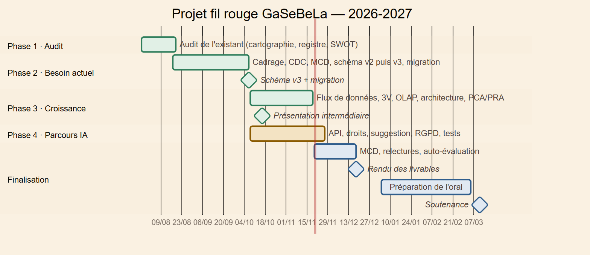

> **Version complète, gardée en annexe.** Le livrable est la version courte : `livrables/2-modelisation/2.3-note-de-cadrage.md` (2026-11-20).

> **Copie de Confluence** — page « Note de cadrage » (id 17498130, version 13), espace GaSeBeLa1, copiée le 2026-11-19.
> La source qui fait foi reste Confluence : https://laurenceamethyste.atlassian.net/wiki/spaces/GaSeBeLa1/pages/17498130/Note+de+cadrage. Les images, schémas draw.io et encadrés ne passent pas dans l'export : ils sont signalés par une ligne « 🖼️ Image ou schéma non copié : <nom ou légende si connue> ».

**À COMPLÉTER** — sections 3 à 10 complétées le 2026-11-03 depuis le brouillon v5 (`md/equipe/note-de-cadrage-complements.md`), avec l'accord de Békanty (R) et de Sébastien. Les points 🟡 restent à compléter par l'équipe. La version précédente est dans l'historique de la page.

## 1. Contexte 

L’entreprise de chasse immobilière du sujet (l'équipe projet s'appelle GaSeBeLa), actuellement en phase d'expansion à l'échelle nationale et européenne, repose sur un Système d'Information (SI) artisanal présentant une dette technique majeure (Voir phase 1). Le backend actuel, dont le code source n'est plus exploitable, utilise un modèle de données rigide, des champs en texte libre inexploitables pour l'IA, et une absence de gestion temporelle des mandats, représentant un frein majeur à la croissance européenne visée et une exposition juridique réelle (litiges sur mandats expirés).

---

## 2. Objectifs

* **Fiabiliser l'intégrité des données** : Séparer les rôles (Clients/Chasseurs) et structurer les attributs pour garantir l'intégrité de la base.
* **Sécuriser la conformité juridique :** Automatiser le cycle de vie des mandats (durée de 6 mois, traçabilité des signatures et des renouvellements)
* **Structurer et automatiser la recherche de biens:** Remplacer le texte libre par des critères typés et historisés (versioning), préparant le matching automatisé par IA
* **Pérenniser l'architecture :** Adopter PostgreSQL (choix ADR-001) et une convention de nommage en anglais (ADR-002) pour faciliter l'intégration internationale.

---

## 3. Périmètre

**Dans le périmètre (IN)**

* Refonte complète du modèle de données : MCD/MLD cible, puis schéma PostgreSQL **v3** de **22 tables** (comptes, fiches clients et chasseurs, demandes et critères versionnés, mandats, biens, propositions, visites, offres, ventes, paiements).
* Une **API backend** en Python (FastAPI + SQLModel) sur PostgreSQL : un CRUD complet, des droits par rôle, et le calcul de rémunération du sujet.
* La **migration** des données existantes vers le nouveau schéma (`migration.sql`, rejouable), avec le nettoyage des anomalies de l'audit.
* Le **flux de données** : import des annonces chaque nuit (Airflow), stockage brut (MinIO), recherche (Elasticsearch), logs (Kibana), et un schéma analytique (OLAP).
* Un **moteur de suggestion de biens** simple, à base de règles (v1), pour préparer l'IA.

**Hors périmètre (OUT)**

* Aucun site web ni écran (pas de « front ») ; aucune mise en production.
* Pas de page de connexion : on fournit seulement les outils côté serveur (connexion, jeton, rôles, droits) — Product Owner, entretien du 07/10.
* Pas de facture en base — Product Owner, entretien du 07/10.
* L'acte chez le notaire n'est pas géré ; sa date et son prix restent des entrées du calcul.
* Pas d'entraînement de modèle d'IA : le sujet demande de **concevoir** la base qui le nourrit, pas les modèles eux-mêmes.

---

## 3 bis. Contraintes et hypothèses

**Contraintes** (ce qui nous est imposé)

* La base est **PostgreSQL** (ADR-001) ; les noms du code sont en anglais (ADR-002).
* Tous les montants sont en **euros**.
* Les fichiers d'origine du sujet (le StarterPack) ne se modifient jamais.
* Tout tourne en local, avec Docker et des outils gratuits.
* Les données sont **fictives** : celles du sujet, et des données générées.

**Hypothèses** (ce qu'on suppose vrai)

* La croissance prévue : plusieurs milliers de mandats par semaine, et des centaines à des milliers de biens par recherche (énoncé).
* Les chiffres de la rémunération sont ceux proposés par le sujet ; ils restent des paramètres, que l'entreprise pourra changer.

---

## 3 ter. Gouvernance

* **Le Product Owner**, qui représente l'entreprise, valide le périmètre et les livrables.
* **L'équipe décide ensemble** : une question ouverte se vote sur Discord ; la décision est écrite dans un ADR (journal de décisions, Confluence).
* **Chaque livrable a un responsable (R) et un valideur (A)** : voir le RACI.

---

## 4. Livrables attendus

**Phase 1 : Audit de l'existant**

* **Dossier d'audit :** cartographie du SI et registre des anomalies/risques.
* **Étude d'opportunité :** analyse de la problématique et de la transformation digitale.

**Phase 2 : Réponse au besoin actuel**

* **Pilotage :** Note de cadrage, Backlog priorisé (MoSCoW).
* **Conception fonctionnelle :** Cahier des charges technique
* **Architecture des données :** Note stratégique d'évolution, MCD/MLD cible complet, script `migration.sql`, note d'indexation.

**Phase 3 : Croissance et Big Data**

* **Infrastructures :** Dossier d'architecture (comparatif OLTP/OLAP, composants), Matrice de décision d'architecture, Note d'environnement technique.
* **Données :** Note de dimensionnement 3V (volume, vélocité, variété), Schéma analytique (OLAP) incluant la description de l'alimentation et une note sur la qualité des données.
* **Continuité :** Matrice des risques, Plan de mitigation, PCA/PRA.

**Phase 4 : Parcours futur avec l'IA**

* **Applicatif :** Dossier de conception applicative (maquettes, patterns justifiés), Extraits de code commentés.
* **Intelligence Artificielle :** Schéma du programme d'IA, Note de conception du modèle de matching accompagnée du jeu de features documenté.
* **Qualité :** Plan de tests (unitaires et fonctionnels) avec rapports d'exécution, Pipeline CI et indicateurs de qualité, Note de sécurité applicative.

**Livrables transverses (Exigences obligatoires)**

* **Juridique :** Registre de traitement RGPD (finalité, base légale, données sensibles).
* **Green IT :** Note d'éco-conception (incluant l'arbitrage coût/rétention des sauvegardes).
* **Inclusion :** Note de préconisations d'accessibilité PSH (espace acquéreur).
* **Sécurité IA :** Note sur la souveraineté et la sécurité liées à l'ouverture des données à l'IA.

**Pilotage continu (Toutes phases)**

* Planning projet (Gantt) et jalons.
* Matrice RACI et comptes rendus d'atelier.

---

## 5. Parties prenantes

_Pour les rôles et responsabilités des parties prenantes du projet, voir le_ `RACI` _(proposition du 03/11, à valider)._

| **Partie prenante** | **Fonction dans le projet** |
| --- | --- |
| Formateurs (Jean-François, Richard) | **Product Owner** |
| Jury | **Sponsor** |
| **Equipe technique** |  |
| Sébastien | l'API backend, le modèle cible, la migration, l'architecture, l'OLAP, les tests |
| Laurence | le registre des anomalies, le journal de décisions, la conception de l'appli, la matrice de décision, la note souveraineté IA |
| Békanty | la note stratégique, la note de cadrage, le cahier des charges, le SWOT, le MoSCoW, l'accessibilité |
| Gabriel | l'organisation du dépôt, la cartographie, l'étude d'opportunité, le RGPD, la note 3V, l'éco-conception, le PCA/PRA, la note d'indexation |

---

## 6. Planning et jalons

| **Jalon** | **Date cible** | **Livrables associés** |
| --- | --- | --- |
| Phase 1 — Audit de l’existant | du 27 juillet au 19 août 2026 | registre des anomalies, cartographie, rapport d'audit |
| Phase 2 — Besoin actuel | du 17 août au 7 octobre 2026 | note de cadrage, MoSCoW, CDC technique, MCD/MLD cible, `migration.sql`, note d'indexation |
| Phase 3 — Croissance | du 8 octobre au 19 novembre 2026 | dossier d'architecture, matrice de décision, note 3V, schéma OLAP, éco-conception, PCA/PRA |
| Phase 4 — Parcours futur avec l'IA | du 8 octobre au 27 novembre 2026 (fin proposée) | API, plan de tests, schéma du programme d'IA, conception du matching, note souveraineté |
| Présentation intermédiaire | 2026-10-16 | diaporama |
| Soutenance | 11 mars 2027 | dossier professionnel, oral individuel |

---

**Notes sur le planning :**

* **Phase 1 (réalisé) :** Les travaux d'audit, la traçabilité des anomalies et le choix des outils (ADR) ont été finalisés, servant de base de données certifiée pour les phases de construction.
* **Phase 2 :** cette étape porte sur la modélisation relationnelle (MCD/MLD cible) qui permettra de passer d'un schéma "à plat" (historique) à une architecture relationnelle normalisée.
* **Phase 3 et 4 :** Ces phases conditionnent la montée en charge vers l'international et l'intégration des fonctionnalités avancées (IA) qui dépendent directement de la qualité du modèle de données structuré en phase 2.

**Diagramme de Gantt** — première version du 19/11/2026, à ajuster par le groupe ; 3 dates sont proposées (fin de la phase 4, rendu des livrables le 18/12/2026, début de la préparation de l'oral le 04/01/2027). Détail et sources : page « Planning (Gantt) et jalons ».

---

## 7. Ressources

* **Humaines** : une équipe de 4 data engineers (Sébastien, Laurence, Békanty, Gabriel), qui reprend le SI de la société de chasse immobilière après le consultant précédent ; le Product Owner représente l'entreprise.
* **Techniques** : nos ordinateurs, et une pile Docker locale : PostgreSQL, l'API, MinIO, Airflow, Elasticsearch, Logstash, Kibana.
* **Outils de travail** : GitHub (code, et un kanban GitHub Projects), Confluence (documentation), Discord (échanges), un assistant IA (Claude) pour aider à coder et à relire.
* **Budget** : non communiqué par l'entreprise (à revoir si le Product Owner en donne un). Les outils utilisés sont gratuits.

---

## 7 bis. Démarche et qualité

* **Démarche** : un projet découpé en **chantiers**, eux-mêmes découpés en petites tâches d'une séance ; chaque tâche suivie sur le kanban ; les décisions votées sur Discord et notées dans le journal (ADR, Confluence).
* **Qualité** :
    * des **tests automatiques** à chaque changement du code (plus de 1 000 tests, tous verts au 03/11) ;
    * chaque tâche de code est relue avant d'être enregistrée (commit) ;
    * chaque décision importante a sa trace écrite (ADR).

---

## 8. Risques identifiés

Deux familles de risques : ceux du **système d'information** (trouvés à l'audit de la phase 1), et ceux de la **conduite du projet**.

### 8.1 Les risques du SI, repris de la phase 1

Sources : pages « Audit du système d'information » et « Registre des anomalies — Existant ». L'audit a coté **16 problèmes** (probabilité × gravité, de 1 à 9) : **3** en priorité absolue, **9** à corriger impérativement, **4** mineurs.

**Cotes** : registre coté de la phase 1 (`livrables/1-audit/1.2-registre-anomalies-risques.md`, dépôt Fil-Rouge), probabilité × impact, de 1 à 9. 🟥 7 à 9 : priorité absolue · 🟨 4 à 6 : impérative · 🟩 1 à 3 : mineure.

| Cote | Risque trouvé à l'audit | Impact | Parade dans le nouveau système |
| --- | --- | --- | --- |
| 🟥 R01 · 9 | Des mandats « actifs » ont dépassé leurs 6 mois (6 sur 11 au 25/07) | facturer sur un mandat expiré : risque juridique | date de signature et date de fin calculée (signature + 6 mois), contrôlées par la base |
| 🟥 R02 · 9 | Un chasseur enregistré comme client (mandat 13) | les rôles se mélangent | clients et chasseurs dans des tables séparées : l'erreur devient impossible |
| 🟥 R03 · 9 | Les honoraires n'existent nulle part | pas d'historique du chiffre d'affaires | tables des ventes et des paiements, et calcul de la rémunération |
| 🟨 R08 · 6 | Taux de commission fixe, alors que la règle est un barème | rémunération fausse | une table de barème (tranches de montant) |
| 🟨 R07 · 6 | Critères de recherche en texte libre | impossible de filtrer, ni de nourrir l'IA | critères structurés et gardés version par version |
| 🟩 R11 · 2 · 🟨 R12 · 4 · 🟩 R13 · 2 | Email, téléphone, code postal sans contrôle | données fausses ou en double | contrôles de format dans la base |
| 🟨 R09 · 6 | Le code de l'application est perdu | plus personne ne peut faire évoluer le système | une nouvelle API, sur GitHub, couverte par des tests |
| 🟨 R16 · 6 | Données personnelles en clair | non-conformité RGPD | registre RGPD, droits par rôle, compte en lecture seule pour l'IA |
| — (enjeu du projet, pas un défaut de l'existant) | La croissance (des milliers de mandats par semaine) | le système ne tient pas la charge | architecture dimensionnée : note 3V, schéma OLAP, Elasticsearch |

### 8.2 Les risques de la conduite du projet

**Cotes** : probabilité × impact, de 1 à 9, même méthode que l'audit (P 3 = déjà arrivé dans le projet). 🟥 7 à 9 · 🟨 4 à 6 · 🟩 1 à 3.

| Cote | Risque | Impact | Parade envisagée |
| --- | --- | --- | --- |
| 🟨 P2 × I2 = 4 | Un membre absent ou surchargé | des livrables en retard | le RACI répartit le travail ; chacun a un remplaçant qui valide (A) |
| 🟥 P3 × I3 = 9 — 88 % des commits sont de Sébastien (645 sur 729, dépôts Fil-Rouge et Fil-Rouge-API, au 19/11) | Le travail repose trop sur une personne | un oral fragile, une charge inégale | répartir les livrables manquants (RACI du 03/11) ; chacun relit les parties des autres |
| 🟩 P1 × I3 = 3 — restauration testée le 19/11 (2,82 s, 0 écart) | Perdre des données ou du travail | des jours de travail perdus | tout est sur GitHub et Confluence ; sauvegardes et plan de reprise (PCA/PRA) |
| 🟩 P1 × I3 = 3 — données fictives ; droits par rôle testés | Données personnelles mal protégées | non-conformité RGPD | registre RGPD, droits par rôle, compte en lecture seule, données pseudonymisées |
| 🟨 P3 × I2 = 6 — erreurs constatées et corrigées à la relecture le 19/11 | L'assistant IA se trompe | un livrable faux | relire chaque sortie, tout vérifier contre le sujet et le code |
| 🟨 P3 × I2 = 6 — chantier MER clos sans rien livrer (03/11) | Le périmètre déborde | du temps perdu sur l'inutile | le hors-périmètre ci-dessus, validé avec le Product Owner |
| 🟨 P3 × I2 = 6 — constaté le 19/11 | Le Product Owner est injoignable | des priorités et des choix restent sans validation | l'équipe tranche et l'écrit (backlog MoSCoW, ADR) ; les questions restent prêtes pour lui |

---

## 9. Critères de réussite

* Chaque livrable de la grille d'évaluation existe, au bon format.
* La base v3 tourne, la migration se rejoue, et les tests passent.
* Les règles métier du sujet sont respectées (rémunération, mandats, droits).
* **Chaque membre sait expliquer tout le projet**, y compris les parties des autres, et peut le présenter seul.

**Indicateurs** (un chiffre par objectif ; les cibles sont à valider)

| Objectif (section 2) | Indicateur | Cible |
| --- | --- | --- |
| Fiabiliser l'intégrité des données | anomalies du registre d'audit traitées par la migration | toutes |
| Sécuriser la conformité juridique | mandats expirés encore actifs | 0 |
| Structurer la recherche de biens | critères de recherche en texte libre | 0 |
| Pérenniser l'architecture | tests automatiques verts | 100 % |
| Livrer le projet | livrables de la grille d'évaluation présents (21 lignes) | 21 sur 21 |

---

## 10. Validation

| Version | Date | Rédigée par | Validée par |
| --- | --- | --- | --- |
| 1 | 2026-08-21 | Békanty | 🟡 à compléter |
| 2 | 2026-11-03 | Békanty | 🟡 à compléter (A du RACI : Sébastien) |

---

## Méthode pas à pas

1. **Relire le contexte** du projet (le Readme principal) pour le résumer fidèlement.
2. **Formuler les objectifs** en partant du besoin, pas de la solution.
3. **Tracer la frontière** du périmètre — surtout le hors-périmètre.
4. **Lister les livrables** en s'appuyant sur la traçabilité des compétences.
5. **Poser les jalons** en cohérence avec les phases du fil-rouge.
6. **Faire valider** (dans ce projet : par le formateur jouant le commanditaire).
