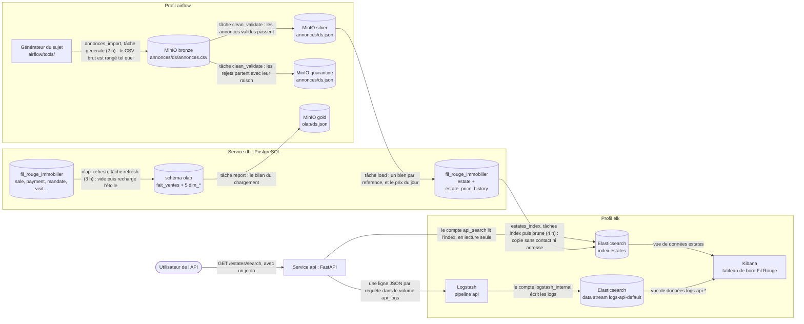

# Le flux de données — schéma avec les vrais noms

> Chantier FLX, fiche FLX12 (2026-10-15). Promis à Laurence au cadrage : un
> seul dessin, avec les noms qu'on retrouve dans le code. Le code vit dans le
> dépôt **Fil-Rouge-API** (`airflow/`, `API/`, `docker/`) ; les décisions sont
> dans les ADR 059 à 064 (`md/adr/`).

## Le dessin

Chaque flèche porte une phrase : ce qui passe, et qui le fait.

## Les trois DAG

| DAG | Heure (cron) | Tâches | Ce qu'il lit | Ce qu'il écrit |
|---|---|---|---|---|
| `annonces_import` | 2 h (`0 2 * * *`) | `generate` → `clean_validate` → `load` | le générateur du sujet | `bronze`, `silver`, `quarantine`, `estate`, `estate_price_history` |
| `olap_refresh` | 3 h (`0 3 * * *`) | `refresh` → `report` | `sale`, `payment`, `mandate`, `visit`… | schéma `olap`, `gold/olap/{ds}.json` |
| `estates_index` | 4 h (`0 4 * * *`) | `index` → `prune` | `estate` | index `estates` |

- L'ordre des heures suit les dépendances : les biens importés à 2 h sont dans
  l'OLAP à 3 h et dans la recherche à 4 h.
- Les trois se lancent aussi à la main, depuis `docker/` :
  `docker compose exec airflow-scheduler airflow dags test <dag> <date>`.
- Rejouer une date ne crée aucun doublon : clé `reference` pour les biens,
  `id_sale` pour les ventes, `id` du bien pour l'index.
- `smoke_dag` (FLX2) n'a pas d'heure : c'est l'essai des connexions.

## Les comptes

| Compte | Où | Droits |
|---|---|---|
| `airflow_indexer` | Elasticsearch | écrit dans `estates`, rien d'autre |
| `api_search` | Elasticsearch | lit `estates`, rien d'autre |
| `logstash_internal` | Elasticsearch | écrit dans `logs-api-*`, rien d'autre |
| `elastic` | Elasticsearch, Kibana | administrateur : pour les humains, jamais dans le code |
| `minio_default`, `fil_rouge_db`, `elasticsearch_default` | connexions Airflow | lues dans `docker/.env` par `AIRFLOW_CONN_*` |

Les mots de passe ne sont que dans `docker/.env`, jamais dans git ; leurs noms
sont dans `docker/.env.exemple`.

## La mémoire par profil

Mesurée au repos le 2026-10-15 vers 16 h 30, tous profils lancés, par
`docker stats --no-stream` :

| Profil | Services | Mémoire mesurée |
|---|---|---|
| sans profil | `db` (125,9 Mio), `api` (108,4 Mio) | ≈ 234 Mio |
| `airflow` | `airflow-webserver` (893,7 Mio), `airflow-scheduler` (525 Mio), `minio` (133,5 Mio) | ≈ 1 552 Mio |
| `elk` | `elasticsearch` (1,705 Gio), `kibana` (914,6 Mio), `logstash` (648,7 Mio) | ≈ 3 309 Mio |
| tout (`--profile "*"`) | | ≈ 5,0 Gio |

- `elasticsearch`, `kibana` et `logstash` ont un plafond (`mem_limit`) : 2 Gio,
  1 Gio et 1 Gio. Kibana tourne près du sien (914,6 Mio sur 1 Gio).
- D'où le conseil du README de l'API : 6 Go pour Docker si tout tourne ;
  sinon, arrêter un profil.

## Pour aller plus loin

- Le cours : `md/flux/cours-airflow-synthese.md`,
  `md/flux/cours-elasticsearch-synthese.md`.
- Lancer, tester, importer le tableau de bord : `API/README.md` du dépôt
  Fil-Rouge-API, sections « Airflow » et « Elasticsearch et Kibana ».
- Le modèle en étoile et ses choix : `livrables/2-modelisation/olap.md`.
